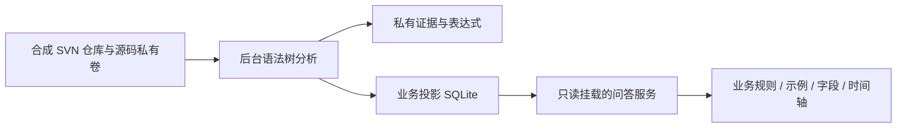

# 代码驱动业务知识：本地 SVN 演示

这是 [SVN 代码知识 OpenSpec 提案](../../openspec/changes/add-svn-code-knowledge/proposal.md) 的独立可运行样例。用真实本地 SVN、确定性语法树解析、SQLite 业务投影和浏览器问答，演示从代码到业务知识的闭环。不接入现有生产服务，也不把提案实施任务标记完成。

## 运行

在项目根目录执行，要求 Docker Desktop 可用，首次构建需要网络下载公开依赖：

```sh
docker compose -f examples/code-knowledge-demo/compose.yml up -d --build
```

打开 [本地演示](http://127.0.0.1:8766)。只有这个端口绑定到本机回环地址；worker 没有宿主机端口，两个服务使用内部 Docker 网络。

Web 另接一个只用于浏览器入口的网桥，默认网段为 `172.16.240.0/28`，避免本机 Docker 默认地址池耗尽。若此网段已占用，可通过 `CODE_KNOWLEDGE_DEMO_SUBNET` 指定另一个空闲网段。它不连接现有平台网络。

停止服务并保留演示提交与知识：

```sh
docker compose -f examples/code-knowledge-demo/compose.yml down
```

重新启动会保留进度。需要从零开始时可用不同 Compose 项目名创建新卷，先停止旧服务避免端口冲突；不要删除现有平台卷。这里没有接入任何真实 SVN、模型、数据库凭据或业务数据。

## 体验顺序

1. 查看默认知识。Java：审批函数在金额不超过 100000 分或具有财务身份时返回允许；C++：数量大于 0 且不超过 100；Vue：已审批标记决定页面按钮可用性。原始注释故意写错，但不参与规则判定。
2. 点击“收紧审批金额与数量范围”。这会真实修改合成代码并提交 SVN，后台每 2 秒补扫，知识变为 50000 分和 50；时间轴新增两条前后变化。
3. 点击“只修改错误注释”。SVN 修订推进，知识不变，不生成业务变化事件。
4. 点击“恢复原业务规则”。当前规则恢复，时间轴保留收紧和恢复两次事件。
5. 暂停分析，再提交一次不同规则，然后提问。查询固定开始时的 SVN 目标，等待 8 秒后明确暂不可用，不使用旧知识。恢复分析后重新查询。
6. 切换为“访客”：服务端拒绝查询；切回“业务分析员”后可以查询。询问表字段可获取结构元数据；索要源码不会返回源文件或片段。

## 实际做了什么



- `worker.py` 建立 SVN 基线，逐提交处理，固定 revision 导出源码，不执行仓库脚本。基线期间的后续提交继续补齐；不支持的语义阻止连续水位推进。
- `analyzer.py` 使用 Tree-sitter 的 C++、Java 和 TypeScript 语法树读取限定的布尔表达式，并严格检查外围结构。阈值、比较运算、与/或条件来自代码。未知调用、额外方法、宏和变化的模板均拒绝发布。
- 业务术语来自人工声明的合成样例词汇表；它只定义输入叫什么，不提供运算、阈值或结果。返回表达式的数值变化会改变规则和计算示例。
- Vue 只支持样例里的固定单脚本 SFC 与按钮模板；没有完整 Vue 编译器或项目级语义解析。DDL 也只支持四个样例字段的限定建表语法，不执行 SQL。
- 业务事实、变化事件、提交处理记录和进度在同一 SQLite 事务内激活。只改注释和无关路径提交会留下处理记录；规则恢复是新的业务事件。
- 问答服务镜像只含 Web 服务与界面，不能挂载源码或私有证据；业务投影卷只读。公开投影不包含机器表达式、函数名、路径、原始注释或 diff。其内部 worker 接口也没有源码读取方法。
- 问答是固定问题范围内的确定性检索与展示，不调用 LLM、Embedding、Qdrant 或现有 Agent。问题不进入分析器，也不能指定任意路径、来源 URL 或命令。

## 范围边界

这是语义提取原理与更新链路的样例验证，不是任意 C++ / Vue / Java 代码的分析器。它没有调用图、跨语言关联、框架/反射/依赖注入推导、编译条件覆盖、跨进程租约、正式 MCP/Job/Publication、现有角色身份认证或目标项目验收。

角色选择器是明确可切换的演示身份，服务端固定角色授权仅用于展示“授权范围不同，读取结果不同”，不能作为生产安全认证。控制按钮也属于本地演示控制台，正式系统需要独立管理授权。

本样例不证明数据库字段和三个函数存在持久化映射，也不证明三个语言函数处于同一真实执行链。描述的函数资格与页面条件不等同于业务端到端成功，更不等同于生产已部署行为。

正式提案仍采用 Clang、项目匹配的 Vue 编译器与 JavaParser 等路线；这里的限定 Tree-sitter 样例不替代这些实施任务。未知语义会阻止更新，演示没有跳过失败提交或人工纠正流程。

## 验证

```sh
docker compose -f examples/code-knowledge-demo/compose.yml run --rm --no-deps worker python -m unittest -v
python3 examples/code-knowledge-demo/acceptance.py
```

第一条使用临时 SVN 仓库执行解析与连续同步测试；第二条通过真实 HTTP 操作运行中的合成演示，产生演示提交，验证更新、时间轴、固定目标、超时、模拟角色拒绝和无源码出口。重复运行会继续追加提交；界面只显示最近 50 个业务事件。真实浏览器、容器隔离检查和本次结果见 [验收记录](acceptance.md)。

解析依赖版本在 [requirements.txt](requirements.txt) 中锁定。实现参考 [Tree-sitter Python API](https://tree-sitter.github.io/py-tree-sitter/)、[C++ grammar](https://github.com/tree-sitter/tree-sitter-cpp)、[Java grammar](https://github.com/tree-sitter/tree-sitter-java)、[TypeScript grammar](https://github.com/tree-sitter/tree-sitter-typescript)，均为 MIT 许可证项目。SVN 使用 Debian 提供的 Subversion 客户端，本次实际版本在验收记录中记录。
