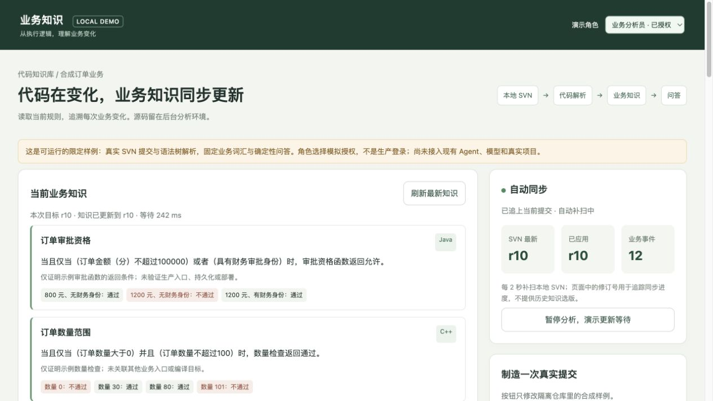

# 本地演示验收记录

日期：2026-10-16。环境：本机 Docker Desktop，Linux ARM64 容器，Subversion 1.14.5。对象：本目录内独立的合成订单业务；不涉及真实 SVN、生产数据库、模型凭据或现有 Agent 发布。

## 实际执行结果

| 层次 | 结果 | 证明范围 |
| --- | --- | --- |
| 解析与临时真实 SVN 测试 | 16/16 通过 | Java / C++ / Vue 限定语法、错误注释、数值边界、AND/OR、未知调用/宏/额外文件拒绝、基线期间提交、顺序处理、重放去重、规则恢复、暂停恢复、进程重建续接、失败不越过、公开投影无源码标记 |
| 运行容器的真实 HTTP 检查 | 14/14 通过 | 自动解析真实提交、前后事件、注释与无关路径无业务事件、查询目标固定、等待超时不返回旧规则、演示角色拒绝、字段允许、源码拒绝、额外参数/跨站操作/源码 URL 拒绝 |
| 浏览器实际交互 | 通过 | 页面获取最新规则；切换访客后清空知识与回答；按钮真实提交；暂停后等待超时；恢复后新规则可查；规则恢复与问答可见 |
| 容器存储隔离 | 通过 | Web 容器不存在 `/private`、`/app/fixtures`、`/app/analyzer.py`；尝试写入业务卷被只读挂载拒绝 |
| 静态检查 | 通过 | 本目录 Ruff、Python 编译、Compose 配置；对应 OpenSpec 提案严格校验；本目录 Markdown 链接与变更空白检查 |

HTTP 检查在演示仓库形成 r1 基线至 r8 的连续记录，结束时 `head = scanned = applied = 8`，8 条业务事件，未暂停，无分析错误。

后续浏览器验证：暂停分析时创建 r9，查询显示“等待 8 秒后知识仍未更新完成，暂不可用；没有返回旧规则”；恢复分析后 r9 激活。随后通过页面恢复原业务规则形成 r10，查询目标和已应用均为 r10，时间轴累计 12 条业务事件。交付时自动同步已恢复，保留演示容器与浏览器入口供用户体验。

超时页面完整证据见 [截图](timeout.jpg)。截图反映当次演示修订，后续操作会继续追加记录。

## 环境问题与处理

初次只使用内部 Docker 网络时，Web 端口未实际发布；追加独立浏览器入口网络时，又遇到本机 Docker 默认地址池耗尽。最终保留 worker 所在内部网络，并为 Web 入口显式配置独立的 `172.16.240.0/28` 小网段，重新启动本演示的 Web 容器。没有清理其他项目网络、停止现有平台服务或删除卷。验收 HTTP 客户端对本机地址禁用代理，避免系统代理干扰回环请求。

## 不属于本次验收

- 真实项目的编译环境、框架、调用链、动态分派、跨语言数据流与业务覆盖率。
- 生产角色、鉴权、MCP、Job、Publication、Agent 模型、Embedding、PostgreSQL 与 Qdrant 集成。
- 正式方案的 Clang / Vue 编译器 / JavaParser 解析路径、持久 worker 租约、进程在激活边界被强杀后的恢复、源码处理模型和发布检查。
- 任意问题的语言理解、真实企业业务规则准确率和生产部署状态。

此演示不修改 canonical specs，不勾选正式提案中的实施或真实环境验收任务。项目现有业务代码、配置和数据库未改动。
