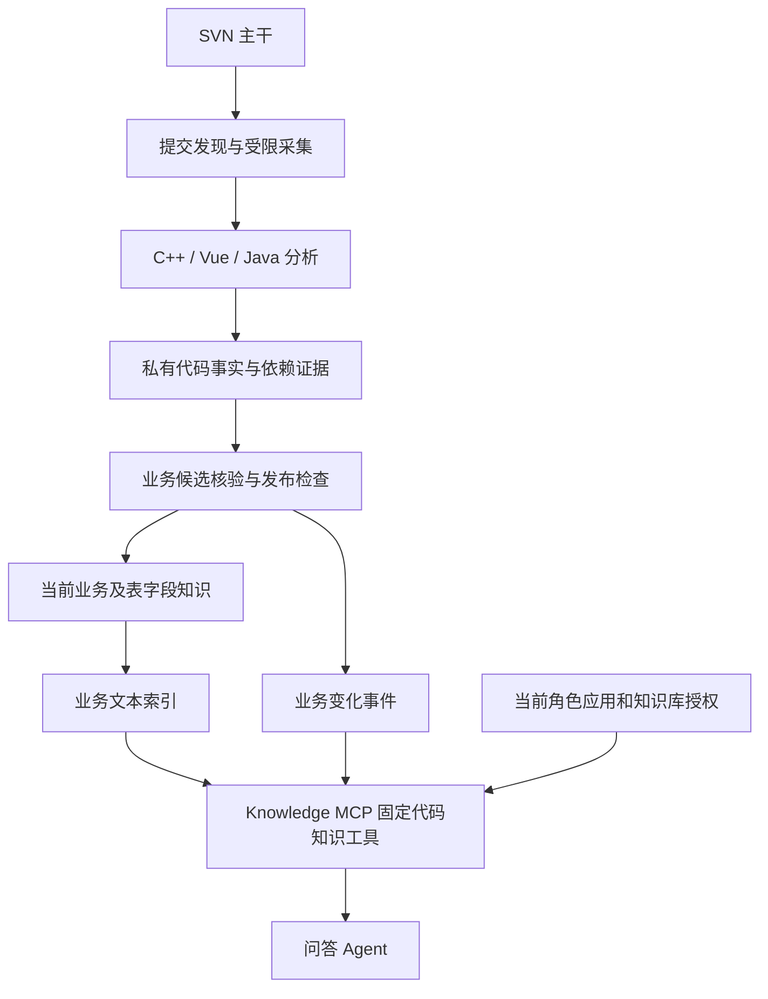

## Context

本设计落实已确认的产品范围：主干最新代码、允许表字段、禁止交付真实源码、角色知识库授权、SVN 自动更新、接入时建立基线并连续记录后续提交，以及更新未完成时有界等待并明确暂不可用。首批源码为 C++、Vue、Java。

当前实现与证据见 [proposal.md](proposal.md)。现有 Knowledge MCP 的来源身份、Tool 依赖和正文读取与 ONES 绑定；既有角色知识库授权、受管 Secret、后台 Embedding、候选索引和同平台原子激活可以复用，但不能把 ONES 工作项或个人可读性伪装成 SVN 的授权模型。

受影响规范仅为 `platform-operations`、`builtin-tool-resource`、`identity-access`、`business-application`。本 change 是待实施提案，不同步 canonical baseline、不补勾其他 change 的验收。

## Goals / Non-Goals

**Goals:**

- 从可执行代码提取带证据的规则、流程、权限条件、状态变化与表字段知识，显式表达不确定和覆盖缺口。
- 通过 SVN 自动发现并顺序处理后续提交，保持当前事实、检索结果、业务变化事件和处理进度一致。
- 同一业务主题的变化能够按提交时间连续查询；当前问题仅使用达到本次查询目标的新知识。
- 复用现有角色配置与应用/Tool/Job 边界；用户无需 SVN 身份，无独立知识 ACL。
- 业务输出允许结构元数据，源码及私有证据不进入在线问答模型、用户附件或可见审计。

**Non-Goals:**

- 不回溯接入前的提交，不根据当前代码补造过去的规则或变更原因。
- 不提供用户可选的知识版本、历史快照浏览、代码浏览/下载、源码 diff 或知识回滚界面。
- 不推断生产已部署状态，不执行目标仓库构建/安装脚本，不读取生产数据库内容来补齐分析。
- 不引入图数据库、通用插件平台、全语言分析引擎、独立角色体系或多仓库分布式事务。
- 不替换 ONES 同步，不放宽 ONES 个人权限；首批受管写入仅使用同平台内容库，独立外部内容库写入不在本次范围。

## Decisions

### 1. 后台分析和在线问答分开，产出采用允许字段投影

增加一个受限 `knowledge-code-worker` 进程，负责提交采集、分析与候选准备；后台解析/模型调用不占用在线 Embedding 队列。控制面负责来源配置、当前角色校验和短事务激活。沿用 PostgreSQL、Qdrant、既有 Secret 与进程部署机制，不增加队列中间件。

分析任务使用明确配置、允许处理该仓库源码的模型连接，不借用业务用户聊天模型配置。分析输入只包含已筛选的必要代码上下文；不将完整仓库直接送入模型。普通用户问题不作为后台任意文件读取指令。

持久业务投影只允许主题、条件、动作、结果、例外、结构元数据、业务示例、覆盖状态及安全引用。私有证据存储保存源码定位、表达式锚点、内容摘要和依赖关系，在线服务数据库账号与网络/卷权限均不能读取源码或该存储。表字段名称可以公开，不以包含技术名称为由一律屏蔽。

发布前检查源码片段、原始 SQL/DDL、diff、凭据、内部下载链接和逐行改写的实现内容。允许提供表字段表格、业务公式与自然语言流程，但不能附带对应实现。失败候选隔离，不先进入可查询索引。模型过滤仅为辅助，真正的边界是存储访问隔离、固定输出合同和发布检查。

选用该方案，是为了让业务问答的实际读取权限与产品承诺一致。仅增加“禁止输出代码”的提示词，或直接给用户模型配置源码搜索工具，都无法满足这一边界。

### 2. 按实际执行路径提取事实，首批明确支持三种代码形态

代码分析分为确定性解析、受限上下文探索、业务事实候选、核验四步。调用与数据依赖保存在普通关系表/解析产物中；不建设全仓库知识图谱产品。

| 范围 | 解析与证据 | 必须保留的限制 |
| --- | --- | --- |
| C++ | 使用 Clang AST/LibTooling 路线，读取函数/类、调用、分支、枚举、状态赋值、SQL 调用与预处理条件；按批准的编译参数解析 | `compile_commands.json` 仅作为参数数据，过滤命令、插件和越界路径；缺失头文件、宏、编译目标或动态分派目标时标记缺口，不把某个编译条件下的逻辑描述为普遍行为 |
| Vue | 按项目实际 Vue 版本使用匹配的 SFC/template 解析器，并解析 JS/TS script、事件、计算状态、表单校验、路由和请求封装 | 页面显示/禁用条件只证明前端行为；需追到真实后端入口才能形成后端权限或业务限制。Vue 版本与依赖以仓库事实核实，不执行 npm 安装脚本 |
| Java | 使用 JavaParser 及符号解析路线，提取类/接口、调用、分支、异常、持久化映射和实际注册入口 | 不预设框架。只有已实现识别规则的注解/注册代码才解析成入口；反射、依赖注入、多态目标或依赖缺失时报告未解析，不凭方法名或注释猜测 |
| 跨层关联 | 通过可解析的 HTTP 路由、请求方法、消息类型、参数映射和调用契约关联 Vue、Java、C++ | 只有名称相似不建立已确认调用关系；跨仓库、外部二进制或动态路由不可达时保留边界 |

正式依赖版本和许可证在实施任务中核实并锁定，不把“使用某解析器”当成框架全部语义已被支持。官方依据：[Clang LibTooling](https://clang.llvm.org/docs/LibTooling.html)、[JavaParser](https://github.com/javaparser/javaparser)、[Vue SFC 编译器](https://github.com/vuejs/core/tree/main/packages/compiler-sfc)。

分析单位为业务操作/主题，而非文件摘要。对一个入口依次检查输入、权限、业务条件、数据读写、状态转换、异常和后续异步处理；补充其调用者和被调用者的必要限制。每个候选事实关联同一提交下的证据集合，保留条件合取/析取、比较边界、单位、舍入规则及例外。

注释、docstring、提交说明、字段注释可以提示查找位置，但不得支持规则成立。测试中的断言是辅助材料，不能代替被测实现。仅发现一个拒绝分支，不能推断其反面必然成功；发出异步消息不能被描述为最终业务已完成。实现与说明冲突时，记录当前实现和待核实差异，不替代码“修正”业务含义。

受限探索有单任务输入体积、符号数量、调用深度、模型调用数和执行时间预算。达到上限应记录未覆盖路径，不能静默截断后标记完整。解析器处理源码与编译参数作为数据，不执行仓库里的脚本、二进制或模型建议的任意命令。

### 3. 事实核验与覆盖状态独立于模型置信度

发布前至少校验：证据存在且内容摘要匹配、证据属于同一目标提交、入口可达性、已解析的调用限制、条件与结果一致、必要异常分支、结构映射来源，以及输出允许字段。

证据定位只能证明引用存在，不能证明概括正确。候选必须能对应结构化条件和结果；关键计算/状态规则以独立预期的受控样例核验。已声明无法静态确定的逻辑，不以模型自报置信度发布为确定事实。

每个主题区分 `CONFIRMED`、`PARTIAL`、`UNRESOLVED`，后两者记录安全的缺口描述。`PARTIAL` 可返回已证实子规则，但不得给出依赖缺失路径的完整性结论；所问结论依赖未解析部分时返回“分析证据不足”。已受变更影响而无法确认的旧规则必须失效或改为缺口，不能继续作为最新事实返回。

技术运行失败、缺失提交、未知影响范围、发布检查失败阻止本批激活和连续进度推进。若影响范围能够被确定且未解析项已被明确隔离，候选可携带这些缺口完成分析；这表示已处理到该提交，不表示所有业务都已理解。管理端分别展示同步进度和业务覆盖状态。

### 4. 表字段是结构化知识，含义来自实际使用

从可访问的建表定义、按已知顺序生效的迁移、实体映射和实际 SQL/ORM 读写中提取表、字段、类型、空值规则、唯一/外键约束、枚举与关系。分别标识物理外键和代码中的逻辑关联，不能把 JOIN 自动称为数据库外键。

字段业务含义由赋值、读取、判断和计算逻辑支持。字段注释不能独立确定单位、状态值或业务用途。映射和迁移矛盾时保留来源及冲突，不猜最终生产结构；描述统一标注“代码定义/使用的结构，未验证生产数据库”。不采集真实行数据，也不把数据库查询权限附加给知识库读者。

### 5. SVN 来源范围固定，首次建立当前基线

一个代码知识库绑定一个明确的 SVN 仓库 UUID 和主干根路径，允许在该根下包含 C++、Vue、Java 子项目。创建时保存 URL、允许/排除路径、受管只读凭据引用、语言与构建上下文、分析模型连接、轮询间隔和资源预算。默认轮询间隔 60 秒，可在受限范围配置；关闭同步后不再声称满足最新查询。

只抓取明确允许的源码与必要声明文件，排除 Secret/环境文件、依赖缓存、构建产物和业务数据。禁用自动跟随 `svn:externals`，拒绝符号链接/路径穿越越出分析根，SVN 命令使用固定子命令及参数数组，禁止用户传入 shell、任意 URL 或证书信任绕过。只读凭据不写入命令参数、日志或仓库工作副本认证缓存。

首次启用时先读取服务端操作修订号 `R0`，固定该提交的清单和内容，建立当前基线。不得在分析中间更新工作副本到新的 HEAD。首次基线只记录“接入时已存在”，不生成规则在 `R0` 新增的虚假事件。

在基线准备前持久化 `R0` 及来源身份；通知和定期补扫持续发现 `R0` 之后的提交。基线失败重试仍以同一 `R0` 恢复，完成后从 `R0` 之后顺序追赶。来源根路径/仓库 UUID 被替换不能无声重置连续进度，必须停止并显式新建来源基线；正常代码移动按范围内可核对的 copy/delete 关系处理。

### 6. 提交通知只加速，连续扫描负责完整性

有 SVN 服务端配置条件时安装轻量 `post-commit` 通知，只发送绑定来源和提交标识，鉴权后持久登记并快速返回，不在提交钩子内执行模型分析。没有 hook 时，轮询仍能完成全部增量处理。[SVN hook 语义](https://svnbook.red-bean.com/en/1.7/svn.ref.reposhooks.post-commit.html)

扫描器从已完整扫描的位置，按固定的服务端上界分页枚举配置路径的日志和变更清单，保存待处理项；通知中的提交号仅是线索，必须回源核实。幂等身份采用来源身份与 SVN revision。重复、乱序或丢失通知不改变处理结果。

SVN revision 是仓库级序列，两个相关提交之间可能夹有其他路径的提交；只有完整扫描证明无关，才允许越过这些号码。不能要求配置子树的提交号逐一连续，也不能把请求失败、未完整分页或权限不足解释为“没有提交”。日志范围与受影响路径可由 SVN 日志接口获取。[SVN log 说明](https://svnbook.red-bean.com/en/1.7/svn.ref.svn.c.log.html)

`applied_through` 表示该位置之前所有范围内相关提交均已应用，不表示每个仓库级号码都产生了知识。完整扫描的区间没有未应用的相关提交时，可以原子推进这一证明位置而不重建索引；存在失败或待处理的相关提交时不能越过它。

每次相关提交都对修改前后可执行代码进行分析，公共方法、枚举、迁移、路由、include 和已登记调用者一并纳入影响范围。无法可靠收窄影响时，在预算内扩大到模块或重新分析配置范围；仍无法完成则保留失败，不跳过中间提交。先收紧后回滚的两次变化都必须留下事件。

### 7. 当前事实、业务事件和处理水位分别存储

沿用已有 source/document/收录、候选索引及资源治理概念，新增只服务本需求的数据对象；最终表名由迁移实现确定。

| 对象 | 主要事实 | 关键约束 |
| --- | --- | --- |
| 代码来源绑定 | 仓库身份、路径范围、配置修订、Secret 引用、分析设置、启用状态、`baseline_revision` | 连接变更必须复核；不保存凭据正文 |
| 同步进度与提交处理记录 | `observed_head`、`scanned_through`、`applied_through`、revision、提交时间、阶段、租约、错误码 | 发现不等于扫描完整，扫描不等于知识可查；单来源顺序激活，提交幂等 |
| 当前业务事实 | 稳定 `topic_id`/`fact_id`、类型、规则或表字段结构、关联主题、证据状态、缺口 | 当前视图仅有一份；标识不以标题或文件行号生成 |
| 业务变化事件 | 稳定事件身份、主题、变化类型、前后业务事实、影响、提交时间、分析时间、来源 revision | 同一提交可有多个主题事件；与处理记录关联，重复重放不追加重复事件 |
| 私有证据与依赖 | 源码锚点/摘要、解析条件、调用/表字段依赖、候选生成事实 | 不向在线问答数据库账号开放，不进入业务索引或附件 |

主题身份以业务操作和可验证实现关联持续匹配；纯重命名/文件移动不能因文本相似度变化制造删除与新增。无法可靠合并时保持独立并记录关联待确认，不让模型静默覆盖无关规则。

当前事实可包含 `rule`、`flow`、`schema` 三类。业务事件类型包含新增、修改、删除；回滚以实际前后规则差异记录，能够核实恢复关系时标注恢复了哪条事件，不凭提交说明单独认定。纯注释或格式提交记录已处理，不制造业务变化。

用户不选择 revision；内部证据、处理水位与资源/索引代际也不成为新的角色授权维度。业务时间轴保留变化所需的前后业务事实，不保存每次完整知识快照，不承诺任意历史全库重建。分析模型/解析器升级后的纠错作为分析纠正单独记录，不冒充新的 SVN 业务提交，也不静默改写旧事件。

### 8. 候选先完成，原子激活后才推进已应用位置

单来源使用数据库租约及 fencing 标识执行工作，其他来源可独立处理。首批使用一个有界 worker 执行槽位，后续容量调整须保持同来源顺序和租约互斥，不创建新的分布式调度平台。

持久阶段为 `DISCOVERED → FETCHED → ANALYZED → VALIDATED → INDEX_READY → APPLIED`；记录安全失败原因与最近成功阶段以便重试。阶段完成持久保存后才能被复用；恢复必须复核来源配置、目标提交和输入摘要，不能复用不匹配候选。

先在不可见候选集合准备业务文档和向量，校验完整规则及索引，再在同平台 PostgreSQL 的短事务中同时提交当前事实、业务事件、活动索引指针及 `applied_through`。Qdrant 不参加数据库事务；通过先准备不可变候选、最后提交引用实现对读者的一致可见性，不能把数据库事务描述成跨存储事务。

当前视图通过活动集合引用不可变事实正文；更新采用替换集合引用，不能原地覆写仍被查询使用的正文。短期读取租约共同保护该批次的事实成员、正文和索引，时间轴固定到同一已应用上界；租约结束后可回收旧批次。只保留旧向量而覆盖旧正文不满足一致性。这里复用内部内容/索引代际以支持在途查询，不形成用户可选或长期保留的全量知识版本。

失败保留原已完成结果供恢复，但只要未达到本次查询目标，查询就不得使用旧结果回答。没有业务变化时可以复用原索引，仍须原子提交该提交已处理事实和连续水位。遇到规则删除或表字段删除，同步移除当前检索入口并追加事件。

激活前复核启用状态、来源配置修订、资源发布绑定、模型/解析 profile、租约和前驱进度；管理员停用或改变配置时旧任务不能继续激活。垃圾回收只清理未引用候选与已过读取租约的临时产物，不删除时间轴来冒充清理版本。

### 9. 最新查询以服务端确认的目标为准，并保持一次回答一致

固定三个新 Tool，均归现有 `knowledge-mcp`，均为只读、无确认写操作；旧 ONES 工具 schema 保持不变。

| Tool | 主要输入 | 主要结果 |
| --- | --- | --- |
| `code_knowledge_list_bases` | 有界目录 cursor | 当前角色可访问的代码知识库安全身份、名称、就绪/更新状态；不返回源码连接 |
| `code_knowledge_search` | `knowledge_base_id`、1–2000 字符 query、`top_k` 默认 5/最大 20 | 相关完整业务事实、必要例外/关联、表字段、覆盖缺口及安全引用 |
| `code_knowledge_changes` | `knowledge_base_id`、可选主题、带时区的起止时间、分页 cursor | 同主题连续变化、前后业务事实、提交/分析时间、覆盖起点与完整性说明 |

搜索返回完整规则，不需要再新增正文详情 Tool。匹配片段只负责召回，回表后装配条件/例外；整条规则不能装入结果预算时明确要求缩小问题，不截掉必要限制后返回“完整”。时间轴按提交顺序稳定分页，时间用于筛选与展示；提交时间相同或时钟倒退时以 revision 和事件次序消歧。目录每页最多 50 项，时间轴每页最多 50 项，单次响应不超过现有 256 KiB 上限。

首次内容查询先完成当前角色、Tool、Job 和知识库授权，再通过平台内部 freshness bridge 读取 SVN 的服务端 HEAD 操作修订号 `Rq`。不得以工作副本版本、目录 last-changed 或上次轮询结果替代这次回源确认。bridge 沿用现有“Knowledge 服务身份 + 当前 Job 的 Knowledge Principal”双身份方式，只接受已注册知识库标识，不接受 URL、Shell、仓库凭据或原始问题；在控制面解析 Secret，MCP 不获得 SVN 凭据。SVN 元数据探测独立于长时间分析槽位，并有短超时。

将 `Rq` 固定到本次 Job invocation、知识库和来源配置对应的内部读取上下文；等待 `scanned_through >= Rq` 且 `applied_through >= Rq`，其间校验授权、Job 存活和配置。总预算复用最多 120 秒且受 Job 剩余时间限制，探测、等待、向量检索和读取共用同一 deadline，不分别重置。

满足目标后获取一份完整活动读取批次，记录其实际截止位置；它可以比 `Rq` 更新，但同一回答的后续检索/时间轴必须复用该批次及时间轴上界，不拼接两批结果。读取上下文为短期服务端租约，不允许用户提供或选择提交号；过期后返回上下文失效，不能在同一回答中无声换批。后续新提交留给下一次查询，不无限追赶。

超时返回 `code_knowledge_not_ready`，无法确认服务端目标返回 `code_knowledge_source_unavailable`，已知分析缺口阻止所问结论时返回 `code_knowledge_analysis_incomplete`；这些都不等于零命中。只有当前目标满足、调用成功且完成本次有界检索后，才允许返回零命中。目录的状态提示不能代替内容查询的新鲜度证明。

问答 Agent 不得用聊天记录中的旧规则绕过这些结果。新的当前规则问题必须执行新鲜度检查；失败时只说明暂不可用，不把旧 Tool 输出重述为最新答案。历史时间段查询也使用完整的当前读取上下文来判断接入后的覆盖，不能隐藏仍未处理的缺口。

### 10. 同一角色授权覆盖规则、表字段和时间轴

使用现有 `BusinessAuthorizationService` 的应用、精确 Tool 与 `knowledge_base_ids` 计算访问，不增加用户 SVN 绑定、每文档 ACL 或额外代码知识角色。当前规则、表字段、变化事件、引用和分页都按同一知识库范围检查。目录只展示有权范围，不以源账号可读范围授予用户权限。

后台 SVN 账号仅用于采集，平台管理员的管理权限不自动获得业务数据读取权限。现有显式拒绝优先、当前成员状态/期限、Job 冻结工具上限和返回前复核保持不变；等待过程中撤权、停用或 Job 结束必须立即停止返回。

应用装配以工具族区分：代码目录与当前查询成套，时间轴工具可额外选配且依赖前两者；ONES 目录/检索继续依赖 ONES 详情。角色只需在现有应用业务授权界面选择已装配 Tool 和代码知识库。不因一个服务器中出现了代码工具就要求 ONES 身份，也不因代码工具通过而跳过同 Job 的 ONES 校验。

需要检查 Manifest、Agent/Application 组合校验、Job Gate、Principal 签发/验证、资源类型和 MCP `tools/list`/调用路由，去除“整个 knowledge-mcp 一律是 ONES”的实现假设。新工具经显式发布才可进入新 Job；旧快照不得被后台改写。后台内容更新可以自动推进当前事实，不代表自动扩大 Tool 或知识库授权。

### 11. 业务时间轴表达实现变化和覆盖范围

首次基线具有“接入基线”标签与覆盖起点；接入前查询返回“此时间范围未收录”，不能声称没有业务变化。基线之后每个相关提交有处理结果，业务事件按稳定主题连接，提供此前规则、当前变化、影响对象及代码证据状态。

保存提交时间和分析时间，内部使用明确 UTC 时间，面向当前用户按 Asia/Shanghai 展示并标明时区。时间轴不以分析完成时间替换提交时间，也不称提交时间为上线生效时间。修改原因只在有来源支持时作为“提交说明中的意图”单列，不能作为行为证据或被臆测填充。

业务查询示例包括“当前工单撤销条件”“领料字段的含义”“接入以来撤销规则调整与回滚”“某字段什么时候新增”。回答只能描述已覆盖范围；当前业务对象的实际状态仍需要已有、独立授权的业务查询工具，本变更不新增生产数据库读取权限。

### 12. 运维和审计保持有界

在现有管理页面增加 SVN 来源的连接引用、路径范围、语言配置、启停、同步进度、最后成功时间、积压、失败重试和安全覆盖缺口。运行开关只控制采集/分析，不是用户授权；停用同步或来源不可达时最新内容查询失败关闭。

日志仅包含来源/任务标识、内部 revision、阶段、计数、耗时和稳定错误码。不得保存源码、diff、完整模型输入输出、原始提交说明、用户原始问题或凭据；私有证据与正常日志分开。管理端也不增加源码预览或通用文件下载。

用固定的源码处理连接与既有受管 Secret 机制配置 SVN 和模型连接，不用仓库 `.env` 或用户聊天传递凭据。对源码中疑似敏感片段在进入模型/知识持久化前隔离；来源内容中的指令不得改变模型配置、发布边界或工具权限。

## Risks / Trade-offs

- [静态分析无法覆盖任意 C++ 宏、Java 动态调用和 Vue 构建语义] → 固定首批语言与实际框架版本，记录编译/解析上下文；未解析保持缺口，未知影响范围阻止激活，不承诺全仓库完全理解。
- [自然语言规则可能丢失条件] → 结构化条件与证据先行、完整规则回表、独立预期样例与语言专项验收；模型复核不能独自证明正确。
- [连续提交高于分析吞吐] → 同来源顺序处理、持久积压、有界模型/解析预算；查询可暂不可用，不合并掉中间变化来假装追上。
- [严格最新依赖 SVN 可达性] → 独立短超时元数据探测与明确失败提示；不提供未经用户接受的陈旧数据降级。
- [代码知识被当成上线事实] → 输出明确“主干代码行为”与配置/运行未验证边界；不接入部署状态推断。
- [后台与在线共享基础资源] → 独立源码 worker 限额及后台 Embedding 路由，沿用在线隔离；不宣称进程隔离就是主机资源完全隔离。
- [发布过滤漏过源码] → 源码与证据访问隔离、允许字段投影、片段/编码/附件/日志多出口检验；自动安全门失败不发布，角色授权不能放开源码。
- [现有 ONES 授权实现耦合] → 新工具合同保持独立，按工具族验证，回归混合应用与旧 Publication；不修改现有 ONES 可读性语义。

## Migration Plan

1. 先确认实际 C++ 编译配置、Vue/Java 版本和框架入口，建立三类最小合成仓库与独立预期；此阶段不连接真实源码和生产数据。
2. 通过现有 Migrator 增加来源绑定、提交处理、事实/事件及证据对象，更新 schema 事实源与 SQLite 等价实现；不重置已有知识或身份数据。
3. 部署默认关闭的受限 worker、解析运行时和内部 bridge；校验依赖版本、资源上限、网络、Secret 引用及无源码输出边界。
4. 在隔离 SVN/PostgreSQL/Qdrant 环境验证基线、每提交分析、故障恢复、时间轴与最新等待，再进行真实浏览器的角色和管理操作验收。
5. 在授权的目标环境配置来源和分析模型，显式启用并建立 `R0`；按实际已装配工具发布 Agent/Application 并配置现有角色知识库范围，使用全新 Job 验收。
6. 停用/回退部署时停止源码 worker 和代码工具准入，保留来源进度与业务时间轴；旧数据不作为最新回答降级。采用向前修复的 schema 策略，不删除事件以回退知识，不影响既有 ONES 读取。

## Open Questions

产品行为已确认，没有待决定的权限模型、查询降级或历史回溯范围。以下是实施/接入前需核实的环境信息，不阻止本提案完成，也不能被假定为已有支持：

- 首批仓库的 SVN 主干路径/服务端版本、只读账号配置入口和 hook 安装条件；只收集连接引用，不在文档或聊天中收集真实凭据。
- C++ 编译器方言/宏/头文件及可用编译数据库，Vue 主版本与 JS/TS 形态，Java 版本/框架/依赖及持久化方式。语言范围已确定为三类，不以其中一类的测试通过替代其余两类。
- 明确允许处理源码的分析模型连接及部署位置，代表性业务主题、仓库规模与可接受同步时延。模型不可用时保持任务失败或等待，不自动换成普通问答连接。
