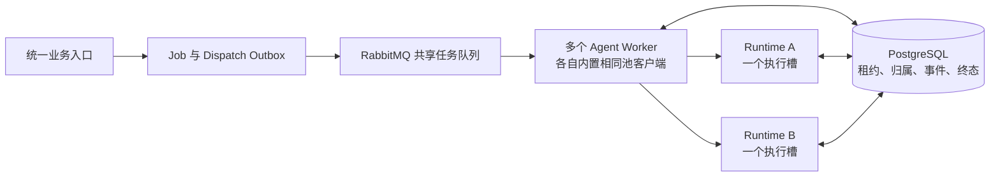

## Context

本设计落实 [proposal](proposal.md) 的增量约束，不替代实际运行证据。用户已确认：首期同一台主机的 Docker Compose、多副本池；同一 Session 串行、不同 Session 并行。提案阶段只生成文档；随后用户调用 apply，当前实施和分层验证见 [验收记录](evidence/acceptance.md)。

当前 canonical baseline 为 [execution-delivery](../../../specs/execution-delivery/spec.md)、[channel-conversation](../../../specs/channel-conversation/spec.md)、[platform-operations](../../../specs/platform-operations/spec.md)。本 change 的三个 delta 相对于这些领域解释，不新建碎片 canonical capability。

提案创建时的静态基线（2026-10-24；不是实施后现状）：

| 实施前事实 | 代码入口 | 对设计的约束 |
| --- | --- | --- |
| 真实 SDK 消费期间持有进程级环境变量锁 | `backend/app/python_runtime/claude_client.py` 的 `_temporary_claude_env` | 每个副本只承载一个真实执行，通过容器数扩并行 |
| Registry 在内存保存执行，另一 owner 的 claim 被判为 ORPHANED | `backend/app/python_runtime/invocations.py` | 必须区分正常跨节点请求与确实失联，先查共享归属 |
| 取消和 terminal 查询只查本地 Registry | `backend/app/python_runtime/service.py` | 取消意图与完成结果需要跨 Worker/节点恢复 |
| consumer 同步执行 handler，prefetch=1 | `backend/app/modules/message_bus/infrastructure/rabbitmq_consumer.py` | 保持一个在途 Job，同时解除长任务对连接心跳的阻塞 |
| RUNNING Job 恢复可由 redelivery 标记触发 | `backend/app/modules/job/infrastructure/repositories.py` 的 `claim_job` | 改为有效租约与领取版本仲裁 |
| 请求摘要包括会话上下文、模型绑定和文件 Manifest | `backend/app/modules/agent/infrastructure/runtime_http_client.py` | 接管不能重建原 attempt 请求 |
| 已有 jobs.manage 管理能力 | `backend/app/modules/admin/domain/capabilities.py` | 取消沿用现有能力和目标业务授权 |

提案阶段未访问真实凭据、业务消息或数据库内容，也未启动 Runtime。apply 阶段使用隔离数据库与合成数据，随后按用户授权复用现有受管模型完成真实 Provider 和有界容量测量；范围和限制见 [真实验收报告](evidence/real-acceptance.md)。

## Goals / Non-Goals

**目标：**

- 业务入口不感知节点，多个独立会话的 Job 可在不同 Runtime 同时执行。
- 一次 Invocation 的执行归属唯一且不可在执行中转移，Worker 可以接管观察与提交职责。
- HTTP 中断、RabbitMQ 重投、Worker 崩溃、取消和终态竞争不会重复启动同一 SDK 执行链。
- 等待、执行、恢复均有截止时间；失联结果不确定时保守失败，并显示资源是否已停止。
- 复用现有 PostgreSQL、RabbitMQ、Outbox 和审计边界，交付可复现的数据库、容器与真实 Provider 分层证据。

**非目标：**

- 跨主机服务发现、自动伸缩、租户加权调度、独立 Pool Gateway 或新的消息中间件。
- 同进程多个真实模型任务、一个节点地址下多个 Uvicorn 进程、运行中 SDK/沙盒迁移。
- 失联后自动重跑结果不确定的执行，或承诺外部 Provider/业务系统的全局 exactly-once。
- 生产数据自动删除、旧进程内状态迁移、全新运维页面或消息投递顺序的全局重构。

## Decisions

### D1. 固定节点池与统一选路



Compose 默认提供 `python-agent-runtime-a`、`python-agent-runtime-b` 和两个 Worker。Runtime 使用相同镜像和共享配置模板，每个命名服务固定一个容器、一个 Uvicorn 进程；Worker 可用普通副本扩展。验收拓扑增加 C 节点及第三个 Worker。

部署配置保存有界的 `node_id → base_url` 映射；节点启动产生不可复用的 `instance_id`。池客户端轮转候选，跳过不可用、排空和发布不一致的节点。候选健康/占用快照只用于选路提示，最终准入由目标节点的原子槽位与 Invocation 状态决定。

每次新执行、重连、取消携带预期节点启动身份，服务端在接受请求前核对。返回的 owner 只含 node/instance ID，客户端只从部署映射找地址，不跟随响应中的任意 URL 或 HTTP 重定向。节点地址、允许主机、协议、构建身份在启动及请求边界验证，不进入 Agent/Application 草稿。

选择固定成员是因为首期只有单机 Compose，稳定地址足以完成归属路由。不采用普通轮询代理作为执行入口，也不引入额外的动态实例注册表。节点 ID 唯一、每节点单容器/单进程是受验证的部署约束，不能对单个节点服务直接 `--scale`。

### D2. 数据事实、权限与保留

以下是逻辑数据模型，实施时 migration 名称按当时序列确定：

| 记录 | 字段或约束 | 写入责任 |
| --- | --- | --- |
| `agent_job` | 复用 `locked_by`；增加 `worker_lease_until`、递增 `worker_claim_version`、`cancel_requested_at/by/reason`、当前 attempt 的 `admission_deadline_at` | Control Plane 写取消意图；Worker 写控制权及业务状态 |
| `agent_runtime_invocation` | 主键 invocation_id；唯一 `(job_id, attempt)`；digest、protocol、Publication 绑定、state、node_id、instance_id、accepted_at、execution_deadline_at、lease_until、cancel_requested_at/reason、terminal_code、execution_quiesced_at | Worker 准备；Runtime 领取/续租/终结；恢复扫描只按条件收敛失联记录 |
| `agent_runtime_request_snapshot` | invocation_id 唯一；不可变 canonical request JSON、摘要、创建时间 | Worker 在准备事务写入；仅受信执行路径读取 |
| Runtime 事件及终态账本 | 沿用现有事件 sequence、终态与完整审计块；写入须核对 invocation 状态和所属实例 | Runtime；失联恢复路径只能写规范化失败事实 |
| Job Dispatch / Delivery Outbox | 保留各自所有权；增加可区分的容量/会话/恢复延期原因与到期时间 | Worker / Dispatcher |

用新的 Invocation 生命周期事实替换旧 `agent_runtime_invocation_claim` 的运行用途，不同时维护两份可变归属。冻结请求是一次 attempt 的不可变执行正文，不能作为第二份可编辑消息；其中包含的 Prompt/上下文使用受控正文存储权限，普通列表、日志和队列只保存 ID、摘要、状态。认证 Header、Grant、Principal、模型 Key 和 Secret 明文永不写入快照。

Runtime 数据库角色只获得所需 snapshot 读取、Invocation 指定字段更新、事件/终态账本写入权限；禁止写 Job、Session、Delivery、RBAC 和平台审计。准备与取消字段、身份字段、终态必须通过专用仓储操作及 SQL 条件保护，不开放通用 patch。Worker 的控制操作不借用 Runtime 凭据。

身份记录和终态不可执行标记至少随 Job 生命周期保留。大块快照/审计的清理服从已有授权与保留边界，并且不得早于所有活动执行、恢复和待提交结果的完成；正文清理后仍保留 digest 和终态标识，返回 `runtime_recovery_expired`，绝不重建 PREPARED。活跃状态不能被 TTL 批量删除。

### D3. Worker 控制租约与事务顺序

Worker 的领取版本用于拒绝过期 Worker 的写入，不改变 Runtime 的执行归属。只有原子领取成功的 Worker 才能推进 Job；续租、安排重试、恢复延期、结果/助手消息/Delivery Outbox 的业务提交均验证当前 owner/version 及有效租约。

RUNNING Job 只有租约到期或旧 Worker 显式交接后才能被接管；`redelivered=true` 本身不授予接管权。失去控制权的 Worker 停止业务写入，不把自己的连接错误写成 Job 失败，不向 Runtime 发送破坏新 Worker 观察的取消。

短事务统一遵守 Session → Job → Invocation → 事件/终态/Outbox 的锁顺序；只涉及 Invocation 的 Runtime 操作不反向锁 Job/Session。模型、MCP、HTTP 流和等待均在事务外运行。结果、最终助手消息、Job 终态和逻辑 Delivery 意图按已有业务事务及唯一键幂等提交，外部 Delivery 仍沿用自己的至少一次及去重合同。

对已经失去有效观察者的 Job，现有 `job-dispatch-worker` 增加有界恢复扫描，以 Job/attempt 唯一身份重新安排观察任务；不创建第二个模型 attempt。重复消息发现有效控制者时，只有已存在可靠的后续观察/恢复事实才可 ACK；不能因当前看见 RUNNING 就丢弃唯一恢复机会。

### D4. 冻结、准入与执行状态机

```text
PREPARED ── 取得槽位且原子领取 ──> RUNNING ── 唯一终态事务 ──> TERMINAL
    └── 取消或准入期限耗尽 ───────────────────────────────────> TERMINAL
```

1. 会话头部 Job 通过当前授权与固定快照检查后，Worker 在同一事务创建 immutable request snapshot 和 PREPARED。请求摘要不包含物理节点地址和会变化的短期认证材料。
2. Runtime 验证 Grant、digest、预期 instance、构建身份和正文合同，先检查已有 Invocation。已有终态走重放；RUNNING 同 owner 走重连；其他 owner 返回安全归属冲突。这些操作不申请新的执行槽。
3. 仅 PREPARED 才尝试非阻塞取得本地唯一槽。满载返回 `runtime_pool_busy`，无状态转移、无后台排队线程、无 SDK 启动。
4. 持槽节点以条件更新领取 PREPARED：取消为空、准入未到期、snapshot/digest 一致；写入不可变 node/instance、accepted_at、执行截止时间和执行租约。只有领取事务已提交才能启动 SDK。竞争失败释放本地槽并读取赢家事实。
5. 领取后、SDK 启动前崩溃也视为可能开始过的执行，禁止从 RUNNING 自动退回 PREPARED；允许保守失败，避免凭“没观察到事件”重复执行。
6. 事件持久化先于发送；终态事务在锁定 Invocation 后提交唯一终态、账本和执行停止证据。相同身份/digest/sequence 的重放幂等，不同摘要或事件内容拒绝。

首期保留现有 ExecutionRequest/RuntimeEvent 的 1.5 默认版本及既有 1.4 接收边界；不为了物理节点地址改写已冻结模型请求。新增池状态、准入错误、最小恢复/取消控制 schema 与严格实例 Header 校验，放入现有合同目录和相应版本测试，仍拒绝未知字段及旧 1.0–1.3 执行。入池还要求同发布构建身份及 `pool_enabled=true`，不存在旧单地址执行 fallback。

### D5. HTTP 控制与恢复

| 接口或调用 | 建议合同 |
| --- | --- |
| `POST /internal/v1/executions` | 用完整冻结请求首次提交或原请求重连；200 为有界 NDJSON，重复连接不创建执行槽 |
| `POST /internal/v1/executions/{id}/recover` | 只接收 invocation/digest，使用新签发的 Runtime Grant；通过持久化绑定授权，返回原事件流；不重新建上下文、加载模型凭据或启动 SDK |
| `POST /internal/v1/executions/{id}/cancel` | 根据持久化事实授权，幂等确认取消意图并唤醒原 owner；不能因本地 Registry 未命中而认定不存在 |
| `GET /internal/v1/executions/{id}/terminal` | 根据持久化身份和 Grant 查询；可在其他合规节点读取已经保存的终态 |
| `GET /ready`、`GET /version` | 提供 node/instance、构建身份、池能力、依赖就绪、排空与占用的有界信息；不调用模型 |
| `POST /api/agent/jobs/{job_id}/cancel` | 复用 jobs.manage、目标 Job 业务范围与 CSRF；只返回安全取消状态，不接受任意 Invocation/节点/URL |

池控制错误使用结构化安全码，客户端按码而不是把全部 409/503 归为同一错误：`runtime_pool_busy`（429，未准入）、`runtime_invocation_owner_mismatch`（409，原 owner 寻址）、`runtime_instance_mismatch`（409，刷新节点身份并核对旧执行）、`runtime_request_digest_mismatch`（409，不可重试）、`runtime_pool_unavailable`（503，延期）、`runtime_recovery_expired`（410，禁止重执行）。owner 和 instance 信息只供已授权的内部客户端使用。

恢复先查数据库状态：

| 持久化事实 | 行为 |
| --- | --- |
| PREPARED | 同一请求可换候选重发；A 的迟到请求与 B 由同一 CAS 仲裁，不凭“HTTP 没返回”生成新 attempt |
| RUNNING 且原启动实例租约有效 | 定向原节点恢复；连接失败有限退避，不重选执行者、不触发模型业务重试 |
| TERMINAL 且正文仍在 | 任一合规节点按 Grant 重放原账本；从 sequence=1 开始，沿用现有有界重放和 Worker 去重 |
| 原实例租约失效或节点已重启，尚无终态 | 重新检查终态后，由有界扫描条件终结为 `runtime_invocation_outcome_unknown` / 结果不确定；禁止自动新增 attempt |
| 只有终态标识、正文已清理 | 返回恢复已过期，不调用模型；Worker 记录可行动的失败/运维事实 |

新 Worker 从持久化请求恢复同一摘要；恢复查询使用独立的最小身份绑定，不因新的外部业务授权被撤销而被迫重跑模型。读取/取消仍要求当前平台服务身份和 Job 访问权限，重新开始新的 attempt 仍完整复核当前业务授权。重发的过期 Grant 重新签发，不能借此延长原执行 deadline。

### D6. 租约、未知结果与实际停止

Worker 控制租约和 Invocation 执行租约独立续约，使用数据库时间比较；本地 watchdog 使用最近一次成功续租换算的保守单调时钟截止点。建议首期部署默认每 5 秒续租、30 秒有效期；仅未到期、身份一致且状态允许的记录可续租，过期不能自行复活。

Invocation 续租失败或执行超时后，Runtime 停止新增模型/工具动作，主动取消 SDK；事件与终态写入再次验证身份、状态和有效租约。失联扫描与正常完成在同一记录上仲裁，只接受一个终态。扫描写的是平台可证明的中断事实，不能伪造模型输出、完整审计或停止成功。

**逻辑终态不等于执行进程已经停止。** `execution_quiesced_at` 只在本地 SDK/子进程已停止，或同一固定 Compose 节点的新启动实例证明旧容器已被替换后设置。节点启动替换证明依赖首期每节点单容器/单进程的部署不变量；地址未知、实例冲突或节点无法联系时不得推断停止。无法自动确认时保留安全阻塞，由受权运维确认旧容器已停止后收敛，不提供模型可调用的“强制完成”能力。

缺少停止证据时不复用该节点槽位，也不放行该 Session 的后续 Job，即使 Job 已显示 FAILED；其他 Session 可继续使用其他健康节点。取消超过 10 秒清理宽限仍无法停 SDK 时，Runtime 隔离自身并退出整个容器，由 Compose restart 清理子进程后产生新 instance。不会只结束 Python 执行线程就宣布资源释放。

此机制阻止旧进程继续修改平台事实，但不能撤销已经到达 Provider/外部系统的请求。受治理外部操作和文件 Commit 继续使用既有幂等/确认合同；本提案不宣称跨系统 exactly-once。

### D7. 持久化取消与竞争规则

取消 API 在短事务内验证 jobs.manage、目标业务范围和 CSRF，写入 actor、固定 reason、时间及 Job 取消意图，并同步当前 Invocation。重复请求返回同一事实；对不存在或无权的目标保持既有防枚举行为。

- 未创建 Invocation：取消标志阻止后续准备，Worker 通过可靠调度终结 Job。
- PREPARED：取消与领取共享条件仲裁；取消先提交则不能调用 SDK。
- RUNNING：先提交意图，再向原 owner 通知；通知丢失时 Runtime 续租/控制轮询仍能发现。
- 成功终态先提交：取消返回 already_terminal，不改写成功。取消意图先提交：成功终态提交被拒绝，清理后写取消结果。
- 正在中止时返回 cancel_requested；确认本地执行停止后才返回 cancelled。失联且停止不确定时报告 outcome_unknown，不能伪称取消成功。

不新增 Job 状态枚举。用户取消映射为 FAILED + `runtime_cancelled`，执行预算耗尽为 TIMEOUT + `runtime_timeout`，准入等待超时为 TIMEOUT + `runtime_admission_timeout`；它们都不增加业务重试。取消不撤回已提交文件或外部操作，不自动生成新任务。

Worker shutdown/HTTP disconnect 不再隐式取消。正常 Worker 排空并在有可靠恢复调度事实后交接 lease；意外退出由 lease/reconciler 接管。Runtime 排空继续支持原调用的控制与恢复，只有显式取消、执行 deadline 或失租才终止模型。

### D8. 并发、延期与连接心跳

每个 Runtime 的新执行与真实模型 probe 共用一个不可超额的槽；健康检查、重连、终态查询和取消不占用该槽。probe 满载时返回稳定 busy，不创建后台隐式等待。每个 Worker 保持一个业务 Job 和 `prefetch=1`，但 Job 执行在线程中运行，连接线程持续处理 RabbitMQ I/O，ACK/NACK 回到原 channel 的连接线程；Job 续租不依赖模型事件到达。

池理论执行槽上限为 `min(可工作 Worker 数, 健康 Runtime 节点数, 可执行 Session 数)`；它不等于 QPS、模型 token 配额或端到端响应时间。

容量不足时，当前 owner 在事务内验证 Invocation 尚未准入，将 Job 从 RUNNING 退回 PENDING（仅限此条件），保存延迟 Dispatch、保留同一 snapshot/invocation/digest 和 admission deadline，再释放控制 lease 并 ACK。Runtime 准入与延期在 Invocation 锁上互斥；若迟到准入已成功，Worker 走原 owner 恢复，不能退回 PENDING。若延期先提交，迟到请求仍可能原子准入同一 PREPARED，后续调度必须识别并恢复，不能重建身份。

延期使用有界退避与抖动，默认 1–5 秒；无空闲节点时不立即 requeue 热循环。准入截止默认从该 attempt 进入可排队状态开始计算 3600 秒，容量/会话延期不能重置；新业务 attempt 才可建立自己的截止时间。WAITING_INPUT 使用既有文件准入期限，进入 PENDING 才开始该准入预算。运行截止以接受事务时刻加冻结 timeout_seconds 确定，重连与租约续期不延长。

Broker ACK 超时必须覆盖最大单次执行预算和有界结果收尾；不能只增大心跳掩盖阻塞。任何异常 ACK 前必须已有终态或可靠的恢复/延期事实，数据库不可用时不 ACK。

### D9. Session 有序执行与上下文

沿用现有完整 Session 隔离键。以输入消息 sequence、Job ID 为稳定顺序，Dispatcher 尽量只发布会话头部任务，Worker 在短事务锁 Session 后原子复核。前置 WAITING_INPUT、RUNNING、RETRY_WAIT 和未确认停止的 Invocation 都会阻止后续执行；有界扫描处理输入/等待超时，不让后续任务长期占用 Worker。

前一 Job 的结果、助手消息及终态提交且本地执行停止后，Outbox 唤醒下一条；未到期的业务重试保持会话头部资格。不同 Session 不共享这一互斥；群聊仍按现有外部身份等完整 Session key 隔离，不扩大为整个群全局串行。

首次构建上下文必须在取得头部资格后：包含前序 Job 已提交的助手结果和允许的历史输入，排除本轮重复输入、attachment_intake 和后续排队 Job 的输入。若 B 输入已排队而 A 的回复稍后才产生，A 的回复即使消息 sequence 大于 B 输入，也必须按 Job 归属进入 B 的上下文；不能简单用“所有消息 sequence 小于当前输入”替代前序 Job 判断。冻结后恢复继续读取原 snapshot。

Session 串行约束的是执行及结果持久化，不承诺外部渠道最终送达的严格顺序；Delivery 继续服从自身合同。

### D10. 就绪、排空与可观测性

节点报告：accepting、busy、draining、unavailable，并分别表达依赖/构建就绪。满载不等于配置不可用；至少一个合规节点可用时池可接收排队任务，成员缺失标记 DEGRADED；全部不可用时报告 UNAVAILABLE，已持久化任务仍受准入预算管理。原 Invocation 的定向恢复不能因为全池无空闲槽而被阻断。

模型 probe 的调用方和现有运行时就绪评估器共同使用池配置/聚合，禁止仍调用被移除的单地址服务。应用管理读写不因临时满载整体失效，不改变业务应用原有接线状态的含义；池可用性作为单独组件运行事实。

新增必要的安全观测：节点/启动实例、Job 控制版本、Invocation 归属、等待原因及年龄、占用槽、重连成功/失败、失租/未知结果、取消至停止耗时、SDK 退出与停止证据。Prompts、完整响应、Token、内部认证材料不进入普通日志；完整审计沿用受保护读取边界。

排空操作是部署管理动作：先禁止新执行，继续已有调用与控制，等待停止/终态持久化后移除节点。新请求遇排空节点重新选择，旧执行不得被搬迁；强制停止明确产生可能中断，不宣称无损迁移。

### D11. 验收矩阵与证据口径

每项证据记录 case_id、层级、构建身份、拓扑、并发配置、操作/故障时间、预期/实际、SDK 启动计数、归属版本、最终 Job/Invocation/Outbox 状态与断言结果。只使用合成数据；普通报告不附业务正文或凭据。没有真实运行的行必须标记 NOT_RUN。

| case_id | 场景 | 最低层级与通过标准 |
| --- | --- | --- |
| RPOOL-01 | 同一 Invocation 同时投递 A/B | PostgreSQL 多连接竞争；只一个 RUNNING owner、一个 SDK 启动；输家不写孤儿终态 |
| RPOOL-02 | 三节点满载及第四任务 | 真实 Compose；三个不同节点 SDK 执行区间有交集，每节点最大1；第四任务等待且 retry_count 不变 |
| RPOOL-03 | 同会话 A/B 与其他会话混合 | PostgreSQL + Compose；B 在 A 结果提交并停止后启动，其他会话能并行；B 包含 A 回复、不含后续输入 |
| RPOOL-04 | 接受提交后 HTTP 响应丢失 | Compose 故障注入；查询/恢复同一 owner、digest，SDK 启动次数仍为1 |
| RPOOL-05 | 领取提交后、SDK 启动前崩溃 | Compose；保守中断，不把 RUNNING 退回 PREPARED，不自动产生新 attempt |
| RPOOL-06 | 流断开及事件重放 | 合同 + Compose；原 owner 恢复，sequence 内容一致、审计不重复、控制请求不占新槽 |
| RPOOL-07 | Worker 崩溃/租约过期 | PostgreSQL + Compose；新控制版本接管同一 Invocation；旧 Worker 的结果/重试/Delivery 写入均被拒绝 |
| RPOOL-08 | Runtime 执行中崩溃 | Compose；唯一中断终态、无自动重跑；其他会话继续；停止未确认时本会话不放行 |
| RPOOL-09 | Runtime 成功后 Worker 事务回滚 | PostgreSQL + Compose；跨节点读取原终态，SDK 不重启，逻辑结果和 Delivery 意图只提交一次 |
| RPOOL-10 | 排队取消/准入竞争 | PostgreSQL；取消先提交则 SDK 启动0；领取先提交则持久化取消并由原 owner 收敛 |
| RPOOL-11 | 运行取消/完成竞争及取消通知丢失 | PostgreSQL + Compose；只有一个终态；轮询能发现取消；未停止不报告 cancelled 或释放槽 |
| RPOOL-12 | 数据库中断及旧 Runtime 恢复 | Compose；租约失效停止执行，旧实例续租/事件/终态写入失败，无重跑或提前复用 |
| RPOOL-13 | 原节点满载时重连/终态读取/取消 | Compose；控制操作可用，不竞争新执行槽；probe 与新执行合计最多1 |
| RPOOL-14 | 排空、节点替换、启动身份变化 | Compose；停止接新任务但原执行可控，迟到请求不能进入新 instance；停止证据可信 |
| RPOOL-15 | Grant/摘要/owner/地址伪造及越权取消 | 合同 + PostgreSQL grants；拒绝越界，Runtime 无 Job/Delivery 写权限，无凭据或正文泄漏 |
| RPOOL-16 | 冻结快照与终态正文清理 | PostgreSQL；恢复不受新历史/Publication/Grant 变化改写；清理后只返回过期，不重新执行 |
| RPOOL-17 | 长任务、RabbitMQ 重连、全部节点不可用 | Compose；连接心跳持续；ACK 前结果/延期可恢复；无热循环；到期仅一个等待超时终态 |
| RPOOL-18 | 确定失败后的业务重试与会话头部 | PostgreSQL + Compose；只有明确可重试且已停止才创建新 attempt，后续会话任务不能越过 |
| RPOOL-19 | 真实 SDK 和 Provider 并行 | 三节点真实运行；SDK/Provider 实际执行重叠、每节点最多1、不同凭据/上下文/沙盒不串用；记录模型限流及结果 |
| RPOOL-20 | 有界容量与恢复耗时 | 固定硬件/模型/负载的真实运行；报告排队/执行 P50/P95/P99、积压、取消/接管延迟与错误率，逐项说明未观测范围 |

单元/合同与 PostgreSQL 竞争验证、确定性 Provider 的 Compose 验证、真实 Provider 验证分别出具结论。RPOOL-19 未通过不能声称真实模型并行已验收；RPOOL-20 是测量报告，不将“3 个槽”解释为站点容量保证。

## Risks / Trade-offs

- [心跳超时可能只是停顿或网络隔离] → 使用不可转移执行归属和保守终态；租约不作为再次启动模型的许可证，缺少停止证据时阻塞相关 Session。
- [共享主机仍是故障点] → 明确本期提供进程/容器级并行与局部故障隔离，不承诺主机高可用。
- [单副本一个槽增加容器开销] → 保持现有 SDK 凭据/环境隔离；先测每副本内存、tmpfs、CPU 和 Provider 限流，再选节点数。
- [固定节点需要修改部署映射] → 复用 Compose 模板和严格映射校验，节点规模未证明需要动态发现前不引入它。
- [严格会话顺序使长任务阻塞追问] → 提供有界等待与取消；其他 Session 仍并行，不静默改变为同会话并行。
- [被冻结的执行正文扩大持久化面] → 单独表权限、不可变摘要、沿用正文授权/保留、禁止进入普通日志与队列；不存认证材料。
- [旧 Worker 或旧 Runtime 迟到写入] → Job 领取版本和 Invocation owner/state/lease 双重检查，终态与投递意图事务化；对抗测试覆盖。
- [逻辑失败但本地 SDK 尚未停止] → 独立停止证据、节点隔离和 Session 闸门；必要时容器级清理，不凭终态释放资源。

## Migration Plan

1. 实施前确认本 change 的三个 delta，按任务清单分层实现；本提案阶段不改 canonical、不勾实现/验收任务。
2. 备份必要持久化事实，停止新入口/消费者接单并排空旧执行。没有新归属记录的旧非终态任务不能自动补为“已归属”；先排空或显式终止，未收敛时阻止切换。
3. 执行 migration：增加 Job 控制字段、Invocation 和受控请求快照，替换旧 claim 运行用途；更新数据库 grants、索引、状态转移和 schema 事实源。历史终态只读保留，不由新模型重建。
4. 协调构建并更新 API、Worker、Runtime 和受影响读取组件，写入同一 release/build 身份；启动两个固定 Runtime 节点及两个 Worker，校验静态映射、单节点单进程、权限和就绪。
5. 在隔离测试拓扑完成 RPOOL-01 至 RPOOL-18，再进行受权的 RPOOL-19/20。真实 Provider 未验收时只报告对应受控验证范围。
6. 升级协议或池控制合同不混跑旧消费者；恢复入口前核验无旧执行、发布一致性和新鲜闭环。普通同版本节点替换可按排空方式逐个进行。
7. 失败时停止接单并保留 Invocation/Outbox/停止状态证据；优先修复前进。不能让旧单地址 Worker 读取新的非终态数据。确需回退时先排空新执行，再恢复匹配的整套发布和数据库备份，不能只退镜像。

## Open Questions

没有阻塞本提案的产品规格问题：部署范围、会话顺序、单槽策略、取消和未知结果处理已确定。

真实环境的目标节点数、硬件容量、模型速率限制及业务延迟 SLO 必须由 RPOOL-19/20 的证据确定。本文的两个默认节点、续租/清理/准入预算是首期可测试的部署默认值，不是生产容量或恢复时延承诺。
