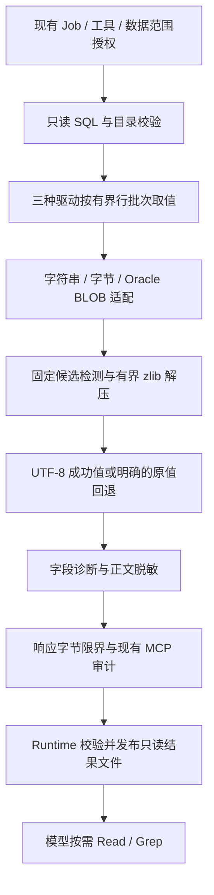

## Context

本设计落实 [proposal](proposal.md) 的数据库压缩字段自动解码增量，相对于 [builtin-tool-resource 主规格](../../specs/builtin-tool-resource/spec.md) 和 [task-file-workspace 主规格](../../specs/task-file-workspace/spec.md) 解释。运行审计继续使用现有 [execution-delivery 合同](../../specs/execution-delivery/spec.md)，不另建审计链。

### 变更前代码基线

| 位置 | 变更前事实 |
| --- | --- |
| `backend/app/modules/mcp_tool_runtime/infrastructure/db/drivers.py` | MySQL、SQL Server、Oracle 共用 `_rows_from_cursor`；一次 `fetchmany(max_rows + 1)` 后按行计算 JSON 字节，二进制等特殊值交给 `default=str`，没有 zlib 解码 |
| `infrastructure/db/executor.py` | `ExecutedRows` 只有列、行、截断和响应字节，尚无字段解码诊断 |
| `direct_executor.py` | 已执行 SQL AST 只读校验、目录/表范围校验，固定调用对应驱动，提供行数和截断原因 |
| `backend/app/services/tool_mcp.py` | 结果经过 `sanitize_for_persistence`、最终响应限界和现有 MCP 审计链 |
| `backend/app/python_runtime/tool_result_bridge.py` | 数据库结果写成 Job 内只读 Markdown 文件，模型仅接收安全摘要和相对路径 |
| `backend/app/shared/query_result_contract.py` | 单次查询结果上限固定为 8 MiB，数据库最大请求行数为 10000 |

用户提供的字段定义是 MySQL `C_OPTEXT MEDIUMBLOB`、SQL Server `C_OPTEXT VARCHAR(MAX) COLLATE Chinese_PRC_CS_AS`、Oracle `C_OPTEXT BLOB`。这些 DDL 证明需要二进制和字符串取值适配，不能证明实际字段使用哪一种包装、标准 zlib 还是其它格式。用户已明确接受第一版只处理严格 UTF-8，其他编码保留原值并标注未解码。

### 当前实施状态（2026-10-06）

本 change 已实现下述固定规则、三驱动接入、Runtime 协议校验和文件摘要。新增 `value_decoder.py` 只依赖标准库；`ExecutedRows.field_decoding` 为可选字段，全部工具目录及输入 schema hash 与 HEAD 基线一致。相关源文件通过 Ruff/mypy；本地专项和既有回归均通过，详细命令与结果见 [实施证据](evidence.md)。

这些是 Confirmed-current 的代码和本地测试事实，未部署到真实环境；三种数据库和实际 PI 写入端格式仍未验收。两份 delta 保持相对于 canonical 的待接受增量，本次 apply 未同步或归档主规格。

## Goals / Non-Goals

**Goals：**

- 三种驱动采用同一组、无配置的内容检测规则，覆盖原始 zlib 字节以及 Base64/Hex 字符串包装。
- 普通值保持原有语义，成功解码有明确标识，失败和超限不会伪装成可读明文。
- 在当前数据库只读、授权、8 MiB 结果容量和 Job 只读临时文件边界内执行。
- 使用一个小型纯解码模块和必要的驱动适配，便于合成测试、故障定位及版本回滚。

**Non-Goals：**

- 通用 CLI、Shell、模型执行 Python、独立 zlib MCP Tool、动态解码脚本或插件系统。
- Resource/Agent/Application/RBAC 新字段、逐表逐列配置、列名白名单或数据库 migration。
- raw DEFLATE、gzip、ZIP、外部预置字典、嵌套/递归解压、自动字符集探测。
- 自动把解压文本变成 JSON 对象、HTML 解释或可执行指令。
- 扩大已授权表范围、调用数据库写入函数、读取 Oracle BFILE 或在 Agent Runtime 安装数据库驱动。
- 将现有 Oracle 11.2.0.4 / Instant Client 19c / Thick 约束改为 Thin 或其他部署基线。

## Decisions

### 1. 解码位于 tool-mcp 取值层

在驱动仍持有原始值和有效连接时完成类型适配及自动检测，再交给现有结果投影、脱敏和文件链路。

理由：Runtime 收到的 JSON 中，原始二进制或 LOB 可能已被字符串化、丢失表示或截断；在该阶段再解压无法保证字节保真。

替代方案：独立解压 Tool 增加模型搬运、授权和大正文传输；Resource 字段映射增加管理/发布负担；数据库原生解压函数不具备三引擎一致性。均不采用。

### 2. 用固定候选集合自动检测，不依赖源列定位

纯解码逻辑建议放入 `infrastructure/db/value_decoder.py`，只依赖 Python 标准库。数据库连接、Oracle 类型检查与 LOB 读取留在驱动层。

| 实际值 | 固定处理规则 |
| --- | --- |
| NULL、数字、布尔及其他现有普通类型 | 不参与压缩检测，保持原有序列化行为 |
| 字符串 | 尝试严格标准 Base64 或严格 Hex 包装，只有得到合法 zlib 头才进入完整解压 |
| `bytes`、`bytearray`、`memoryview` | 先检测原始标准 zlib；不是原始候选时，仅对严格 ASCII 内容尝试上述字符串包装 |
| Oracle BLOB | 由驱动在连接有效期间按预算取出字节，随后使用同一纯解码逻辑 |

Base64 要求标准字母表、正确填充和规范化往返一致；不自动补 `=`、不丢弃非法字符、不尝试 URL-safe 变种。Hex 要求偶数字节对和合法十六进制字符，可接受一个明确的 `0x` / `0X` 前缀，不自动删除中间空白。普通字符串不会被 `strip()`、转码或改写。

候选预检使用 zlib 的压缩方法、窗口和头校验，不能仅按长度或 `eJ` 前缀判断。后续要求：
- 标准 zlib 流，校验和有效。
- `decompressobj.eof` 为真，无 `unused_data`，所有输入被单个流消费。
- 预置字典标志只产生明确的未解码状态，不查询外部字典。
- 解压后的完整字节采用严格 UTF-8；结果仍为字符串。
- 最多执行一次解压，不扫描解压后的 JSON 内部字符串。

理由：检测字节格式无需 SQL 源列追踪，因而字段别名和正常 JOIN 投影不需要新增表/列映射。完整流校验能拒绝截断、损坏及“合法流加额外字节”。

替代方案：遍历任意编码、raw DEFLATE 和字符集会扩大误识别及 CPU 消耗，无法给出稳定解释，第一版不采用。

### 3. 成功投影与失败回退必须明确

解码只改变当前工具结果的可读投影，不修改数据库。

- 成功：结果单元格返回完整 UTF-8 字符串；字段诊断记录 `decoded`、输入包装和前后大小。
- 非候选字符串：保持原样，不因“像 Base64”就返回错误。
- 已识别候选损坏、含尾随数据、需字典、明文非 UTF-8 或解压展开超限：完整原值在预算内时保留，并记录固定状态；不把部分输出、空字符串或替换字符作为成功结果。
- 已完整取得的二进制回退使用明确、可逆的 JSON 表示：`{"type":"binary","encoding":"base64","data":"…","size_bytes":N}`。该表示是原始字节的包装，不是解压明文；其编码膨胀也计入响应预算。
- 无法在输入或最终响应预算内保留完整值时，丢弃整条尚未接纳的行并停止后续读取，标记 `provider_result_truncated`；不返回半个 BLOB 或半个 Base64 值。已接纳行保持完整。
- 底层 LOB 读取失败或执行墙钟耗尽使当前调用安全失败，不发布成功结果文件。

二进制回退是原有 `str(bytes)` / `str(LOB)` 路径的明确修正；普通字符串/数字/NULL 不改变。回退诊断不得让模型把未解码数据描述为已理解正文。

替代方案：所有检测失败均让查询失败，会破坏普通 Base64/Hex 数据查询；静默把错误变为 NULL 会混淆数据库 NULL 与读取失败。均不采用。

### 4. 预算在解码和取值期间执行

沿用 `QUERY_RESULT_MAX_BYTES = 8 MiB`，本次不新增可配置上限：

| 边界 | 第一版代码规则 |
| --- | --- |
| 单字段候选输入 | 原始字节或原始字符串 UTF-8 字节最多 8 MiB；BLOB 必须先检查大小 |
| 单次查询输入处理 | 累计读取/检查的字符串与二进制原值最多 8 MiB，包括失败候选；普通标量的结果大小仍计入输出预算 |
| 单字段解压输出 | 完整输出最多 8 MiB，同时受当前查询剩余展开预算限制 |
| 单次查询解压展开 | 所有尝试累计产生的输出最多 8 MiB，包括最终回退的输出，失败不恢复该处理预算 |
| 数据及字段诊断 | 按最终 JSON 编码共同限界；整条行和该行诊断一起接纳或丢弃 |
| 最终 MCP envelope | 继续执行现有 8 MiB 检查，包含 envelope、安全字段及资源元数据，超限按现有安全错误失败 |
| Runtime 结果文件 | 继续检查 8 MiB 入站结果及现有 15 MiB 单文件/Sandbox 预留边界 |
| 时间 | 取值、BLOB 读取和解压服从该驱动 execute 阶段的剩余墙钟预算，数据库执行上限仍取平台限制与 30 秒中的较小值 |

不能依赖 `zlib.decompress(bufsize=...)` 限制输出。采用分块 `decompressobj` 和每次剩余输出限制，最多读取一个用于确认越界的额外字节，绝不先无界解压再检查长度。

使用有界行批次，避免应用层一次取满 10001 行再检查；MySQL 必须使用适合此路径的流式游标，并在超限时关闭连接终止结果流，不能在清理时无界排空尾部。SQL Server 和 Oracle 保留各自驱动的超时机制，并限制应用层每批数量。只为探测还有下一行，不应继续读取那一行的 BLOB 正文。

当前实现每次 `fetchmany(1)`，并以增量 JSON 字节统计接纳行和诊断，避免反复序列化全部已返回行。MySQL 使用 `SSCursor`，专用连接结束时先解除游标的连接引用再关闭连接，避免 `SSCursor.close/__del__` 排空尾部。Oracle 的 arraysize/prefetchrows 均为 1。各引擎在 execute 阶段设置期限并在 I/O 和解压块前后检查；已超过期限的结果绝不返回成功。阻塞中的原生调用仍服从各驱动现有超时，不宣称 Python 能硬抢占原生 I/O。

zlib 抛出错误时可能无法取得该调用已产生又丢弃的输出；实现保守扣除该次预留的输出块预算，之前消耗的展开字节不恢复。越界探测最多额外产生一个字节，不作为明文或新预算保留。

普通字符串超出剩余输入预算同样不进行昂贵编码猜测；解压总预算耗尽后，剩余候选只可按有界原值回退并标注 `decode_limit_exceeded`，不另开解压预算。未获取完整原值则按行截断。

理由：仅限制最终结果不能阻止读取大字段、Base64 转换或解压过程中消耗资源，也不能让损坏流反复占用“可恢复”的展开预算。

### 5. Oracle 仅适配当前所需的 BLOB

在 `OracleExecutor.execute` 的连接生命周期内，依据实际 Oracle 类型处理 BLOB。先以 `LOB.size()` 检查剩余输入预算，再按有界块调用 `LOB.read(offset, amount)`，统计实际字节和检查剩余墙钟。结果不得保留活动 LOB locator，也不得在连接关闭后再读。

BLOB 识别必须来自固定 Oracle 类型/驱动信息；不对任意具有 `read()` 属性的对象开放读取。BFILE、CLOB/NCLOB 的额外 LOB 读取能力不属于本次所需范围。Oracle BLOB 可以承载原始 zlib 或 ASCII Base64/Hex，不能只看列类型认定一定是压缩数据。

实现使用实际 `oracledb.LOB` 和 `LOB.type == DB_TYPE_BLOB`，先检查 size、按最多 64 KiB 分块读取并重验最终 size。其它实际 LOB 类型安全拒绝，不对 locator 执行 `str()`，因为驱动的 LOB 字符串转换可能隐式读正文。读取异常的底层异常链不传播到普通错误日志；处理超时映射为 `database_query_timeout` 和中文安全提示。

替代方案：全局 `fetch_lobs=False` 会在大小检查之前物化整个 BLOB，并改变所有连接行为，不采用。

### 6. 可选响应字段表达解码状态

`ExecutedRows` 携带按当前结果行索引和返回列名定位的字段诊断，`DirectReadOnlyToolExecutor.query_database` 将其投影到可选 `data.field_decoding`：

- `policy_version = db-zlib-utf8-v1`。
- `candidate_count`、`decoded_count`、`failed_count`。
- `complete`：已返回行中所有识别到的候选是否成功解码；不能解释为所有可能的压缩格式已识别。
- `cells`：候选或二进制回退的有界列表，包含 `row_index`、`column`、`status`、`input_format`、`input_size_bytes` 和适用的 `decoded_size_bytes`。不携带第二份原文、解压片段或堆栈。

固定状态为 `decoded`、`invalid_zlib`、`unsupported_dictionary`、`unsupported_text_encoding`、`decode_limit_exceeded`、`binary_uninterpreted`。前五个状态中的失败项计入 `failed_count`；`binary_uninterpreted` 不证明该值是压缩内容。超限而未接纳的行不占用最终 `rows` 索引，查询截断事实单独保留。

普通值没有字段诊断；没有候选或二进制回退时允许省略整个可选字段。未识别的其它包装不猜测、不虚构候选失败。

Runtime 校验字段类型、版本、状态、计数、行/列引用和大小范围；有字段但不合法时失败关闭，不发布文件。旧响应没有该字段时，摘要只表达“未提供解码诊断”，不能补为解码成功。内联 ToolResult 只投影版本、计数与解码完整性，逐单元格事实随只读文件保存。

理由：查询行覆盖 `truncated/complete`、文件 `file_complete` 和解码 `field_decoding.complete` 是三个不同事实。合法行被全部返回但某字段 UTF-8 不支持，不能靠查询 `complete=true` 声称压缩内容已读取。

### 7. 权限与安全沿用当前合同

自动解码属于已授权 `query_database` 的代码实现，不注册新 Tool，不让任何配置或 Tool Input 提供 codec、脚本、路径、URL、字典或字符集。继续在 Provider I/O 前检查 RUNNING Job、当前用户/角色、Agent/Application 与冻结工具合同及实际数据范围。

字段名称命中现有敏感键规则时，必须先将该单元格替换为 `[REDACTED]`，不读取其 BLOB 正文、不解压、不包装二进制；不能因二进制回退变为对象而绕过原来针对标量的敏感键规则。其余最终解码明文必须先脱敏再进入 MCP 返回、受限业务审计和 Job 结果文件。普通日志、错误、Tool timeline 只包含安全状态、大小和计数；字段正文及原始压缩值不得复制到这些位置。解码出的指令、HTML、SQL 和 Markdown 始终是外部不可信数据。

输入 schema 和 schema hash 保持现有值；响应元数据是加法扩展。工具描述可说明自动解码规则，但不得声称开放通用 zlib/Python 权限。旧 Job 的冻结授权不扩大；验收使用新 Job 证明实际行为。

当前普通 Tool timeline 通过 `tool_response_summary` 只投影固定计数、完整性和策略版本；兼容的进程内数据库查询路径也采用此投影，避免把正文片段送入 `response_summary`。既有受限 MCP 业务审计仍按原脱敏和容量合同保存，不建立新的审计存储。

## Risks / Trade-offs

- [字节格式不等于业务意图] → 完整 zlib/校验/UTF-8 验证后仍可能遇到业务希望查看包装原文的值；所有转换必须显式记录版本与单元格事实，不宣称零误识别。
- [SQL Server VARCHAR 的历史转码可能已丢字节] → 只检测明确可逆包装；不按 COLLATE 猜压缩前编码或重构原始二进制。真实验收核对写入端规则，不能用 DDL 或合成 Base64 通过代替现场格式匹配。
- [UTF-8 以外的业务正文暂不可读] → 保留有界原值并明确 `unsupported_text_encoding`；新增字符集另行确认，不静默尝试 GBK。
- [二进制 Base64 回退扩大输出] → 包装与诊断计入实际 JSON 字节预算，不能容纳完整行时按现有行截断语义停止，不提高全局上限。
- [驱动可能在交付单个字符串/二进制值前分配内存] → 流式行读取减少跨行缓存，Oracle 在读取 BLOB 正文前检查大小；应用层预算不声称替代原生驱动或进程内存限制。真实超大字段检查需覆盖驱动缓冲和清理行为。
- [失败候选拖慢整个查询] → 固定候选集合、头部预检、累计输入/展开预算和剩余墙钟；不递归、不外部字典、不恢复失败的处理预算。
- [新增元数据与真实正文共同超限] → 每条行和对应诊断原子接纳，最终 envelope 与文件边界再次限界。
- [混合版本遗漏摘要] → 可选响应保持兼容；正式验收使用匹配版本 tool-mcp 和 Runtime，缺失元数据只表明未观测，不表明解码成功。

## Migration Plan

1. 实现并通过本地合成数据、三种驱动替身及响应/文件链路测试；新测试归入现有 tier。
2. 严格校验本 change、相关主规格和文档链接；不在实现前同步 canonical。
3. 在受控测试环境部署受影响的 tool-mcp 与包含摘要校验更新的 Runtime 镜像；不修改业务数据库表、角色或 Resource/Agent/Application 发布配置。
4. 通过已有资源、只读账号和新 Job 查询三种数据库的获准合成 `C_OPTEXT` 记录，验证包装、LOB、脱敏、完整性和超限；准备/写入合成记录由独立获准流程负责，不增加 Agent 写能力。
5. 三种数据库真实验收分别记录安全证据；缺少环境、客户端或业务编码规则时保留任务未完成。
6. 回滚时恢复对应服务的前一版本镜像即可；不修改历史 Job、Publication、Resource Revision 或结果审计，不新增配置开关作为回滚旁路。

## Open Questions

- 第一版文本编码已经确认：严格 UTF-8，非 UTF-8 保留原值并标注未解码，无待决字符集规则。
- 实际 PI 写入端采用原始 zlib、标准 Base64、Hex 或其它包装尚未确认；这是现场验收前需要核对的事实，不阻止按明确的固定支持集合实现。若落库格式或字节保真超出集合，应记录未支持并提出后续 change。
- 三种真实数据库测试资源及合成记录准备方式需在验收阶段确定。本次 propose 不读取凭据、现场字段或业务消息，不把环境缺失记作验收通过。

## References

- [Python zlib：流式解压、输出限制、EOF 与尾随数据](https://docs.python.org/3/library/zlib.html)
- [RFC 1950：zlib 头、预置字典与校验和](https://www.rfc-editor.org/rfc/rfc1950.html)
- [Python Base64：严格解码](https://docs.python.org/3/library/base64.html)
- [python-oracledb：BLOB 流式读取](https://python-oracledb.readthedocs.io/en/latest/user_guide/lob_data.html#streaming-lobs-read)
