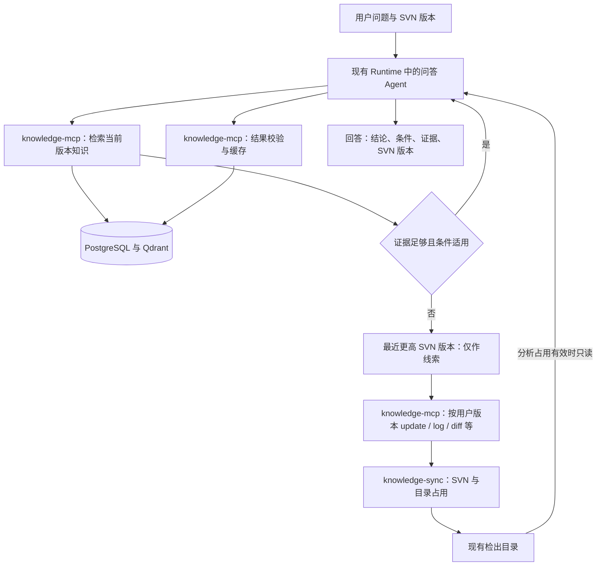

> 实施状态（2026-11-09）：用户已调用 openspec-apply-change 授权实施。以下“仅设计／不改代码”等描述是此前提案阶段的边界；本轮实施进度与验证以 tasks.md 和 implementation-evidence.md 为准，尚未部署的设计不视为线上能力。

## Context

用户已明确采用简化流程：检出目录只读挂给 Runtime，同一个问答 Agent 按需调用 SVN 工具、阅读代码并返回结果，之后按 SVN 版本复用答案。源码范围仍为同仓库同分支的 `set_server`、`set_web/EBR`、`set_web/JTH`；先解释业务规则，生产事实需要另外授权的数据证据。

当前实现仍以预提取单元、专用服务账号和旧源码目录组织授权；`code_history_bridge.py` 的 `BUILD_REQUIRED` 会触发构建；Compose 尚未将检出根只读挂到 Runtime。现有标准 Job、Runtime 池、Knowledge MCP 控制面桥接、SVN 检出及 PG/Qdrant 可复用。以下为待实现设计，不代表当前运行能力。

## Goals / Non-Goals

**Goals:**

- 先查知识，缺少适用证据才查代码；一个问答 Agent 在原 Job 内完成整条路径。
- 直接读取已检出工程；一次分析使用确定 SVN 版本，期间目录不会被平台更新。
- 通过现有 MCP/执行器更新工作副本和查询历史，保留只读 Runtime、权限和预算边界。
- 结论按版本保存，后续同版本问题可复用；保留条件、证据、覆盖与未知项。
- 支持 Windows、macOS、Linux 的统一 Linux 容器部署。

**Non-Goals:**

- 额外源码快照、封存副本、按 revision 建目录、独立提取 Agent/子 Job、整库知识包或预提取。
- 自动 checkout 池、通用读写锁框架、图数据库、Graphify、新增 SVN MCP 容器。
- Runtime 内的 Shell/直接 SVN 写命令、仓库 commit/merge/revert/switch、生产业务变更。
- 本轮实现、清理旧数据、启动模型或更新容器。

## Decisions

### 1. 同一个问答 Agent 完成分析

`knowledge_search` 先按用户必填 SVN 数字版本相等检索；Agent 检查条件和覆盖。不足时可检索同仓库/分支最近更高版本作线索，随后仍核验用户指定版本的代码，不直接套用较高版本答案。来源拒绝、索引/模型依赖故障不能冒充零命中。缺必要业务条件时澄清或说明条件分支，不猜现场配置。

核验是当前 Job 中的一段分析，不再有另一套提取应用、专用执行服务账号或父子 Agent 调度。沿用当前 Job 的真实执行身份和应用权限；未授权查源码的应用仍只能查询已有业务答案。业务核验 Skill 作为当前 Agent 发布的一部分，指导查入口、判断、配置、跨模块依赖和失败路径。

### 2. 直接挂载工作副本

管理员在代码知识库的源码配置中选择已完成检出任务，登记其仓库 UUID、分支、选中范围、受管目录和当前 revision。登记不复制工程、不启动模型；只能登记平台检出根下可核实的目录，不接受任意宿主路径。

同一 `CODE_SVN_CHECKOUT_HOST_ROOT` 默认指向 `.local/code-svn/checkout`，在 `knowledge-sync` 内挂到 `/var/lib/code-svn/checkout` 可写，在两个 Runtime 内同路径只读。Runtime 启动时已有固定根挂载，Job 只获得其中获准 checkout 的路径子集；不需要运行时创建挂载。

保留完整工程和 `.svn` 供执行器使用；模型文件工具拒绝 `.svn`、未跟踪项、未授权 externals、符号链接越界和不支持的文件表示。读取不触发编译或加载仓库中的 `.claude`、`AGENTS.md`、插件配置。代码与提交说明仅作为证据数据。

### 3. 共享读取、独占更新

同一受管 checkout 停留在同一确定 revision 时，多个分析 Job 可以并发持有读取占用；每个占用覆盖本地读取、历史查询、证据校验和结果保存。update/修复/删除等修改操作必须独占：既不能与其他修改并发，也必须等所有读取结束；写操作期间禁止发放新的读取占用。不同目标版本不能同时读取同一目录，不自动为此复制目录。

占用由现有 PostgreSQL 事务和租约机制记录：目录保存写者/代次，每个读任务保存独立占用，绑定 checkout、Job、Runtime invocation/owner、同一 revision 和截止。读者准入与写者准入在同一目录记录上原子判定，不能先查读者数量再无保护地执行写入。所有更新入口，包括 MCP、管理页面、定时采集、修复与清理，都必须检查同一占用；两个 Runtime 的进程内锁或 SVN 自身锁不能替代它。

`knowledge_svn_update` 接受已登记 checkout 和数字 revision，并关联本 Job 的成功搜索与缺证据理由。若目录已核实为 N 且没有写者，原子加入 N 的共享读者并只做只读检查，不实际执行 update。否则仅在无写者、无读者时取得独占，检查工作副本干净、来源和范围相符，再执行固定 `svn update -r N`。确认实际选中项 operative revision 一致、无修改/冲突/switched 后，原子将写占用转换为本 Job 的读取占用并签发 grant；没有允许其他写者插入的空档，此后其他 N 版本读者可加入。

目录忙立即返回 `WORKSPACE_BUSY`，不积累等待另一个模型结束的后台任务。工具执行受 Job 剩余预算约束；长 update 可返回操作 ID 供同一 Agent 有界查询。预算不足时如实返回未完成，结束当前 Job 并停止关联执行；不自动生成另一模型 Job 或跨结束的 Job 继续写目录。

结果提交后先停止本 Job 新的源码读取，等待其在途读取结束，在本 Job 的读取占用内校验证据并保存；成功后仅撤销并释放该读者，其他分析继续，向量派生不持有目录。失败/取消/撤权/Job 结束同样先停止该 Job 的读取与 SVN 子进程，再回收自己的占用。租约到期仅触发恢复，**不能仅凭超时认定旧读取者已停止**；无法确认某读者或写者已停止时禁止更新，不能误删其他任务的占用。update 中断、混合版本或内容变化标为不可分析，核实修复前不发 grant，不自动 revert 用户改动。

宿主可写者也能绕过容器只读挂载，因此登记目录仅供平台管理，运维修改走相同入口。文件工具记录实际读取文件的版本、编码/行范围和 hash，返回证据前及保存时复核；异常变化终止这次分析，不缓存为确定答案。

### 4. 固定工具和授权，不增加模型执行链

| 工具 | 用途 |
|---|---|
| `knowledge_search` / `knowledge_get_code_answer` | 先查相等版本、再取最近更高版本线索；读取完整结论时保留匹配版本与必须核验标记 |
| `knowledge_svn_update` | 更新/确认受管工作副本到指定版本，并为当前 Job 开始受保护的分析阶段 |
| `knowledge_svn_info` | 仓库/工作副本身份、版本及修改/混合状态 |
| `knowledge_svn_log` / `knowledge_svn_diff` / `knowledge_svn_blame` | 冻结历史范围内的提交、差异和行归属 |
| `knowledge_get_source_operation` | 当前 SVN 操作的有界状态/结果 |
| `knowledge_save_code_answer` | 提交本次结论及证据，服务端校验、保存并结束本次目录占用 |

合同、例子、目录状态及跨平台映射见 [svn-tools.md](svn-tools.md)。SVN 命令经现有 Knowledge MCP 的已认证控制面桥接交给 `knowledge-sync`，不直连其他容器。update 是受限本地工作副本修改，结果保存是受限知识派生；二者显式登记副作用和发布授权，可在授权后自动执行，不放宽 ONES/钉钉业务 mutation 的确认规则。

工具集合、来源上限和可见业务范围在 Job 启动时冻结。发布明确授权代码分析的 Job 可预先派生 Read/Glob/Grep，但在成功 update/检查返回有效 grant 前不能读取源码；grant 只能收窄既有来源上限，不能增加工具、仓库或宿主挂载。Runtime hook 对文件路径/占用和 MCP 名称/schema/参数分别校验，异常阻断，并保留初始化审计。当前需求不派生 Write/Edit；代码答案通过结构化工具提交，不要求模型写 JSONL 或 SQL。

一个 Job 同时只持有一个 checkout 的占用；需要比较另一版本时，先完成/保存当前分析并释放，再为另一版本执行同样流程。查询历史 log/diff 不改变当前工作副本；两端证据都不足时明确未知，不用日志代替完整规则核验。

### 5. SVN 身份与证据脱离目录生命周期

用户必须在提问中提供明确数字 SVN 版本；缺失时先补充，禁止用默认值、当前目录版本、现场绑定或 HEAD 代替。知识查询和 update 始终绑定 requested_revision=N。相等版本无适用证据时，由 PG 从同一来源和授权范围的就绪知识版本中取最小 R>N，只检索该较高版本一次；它是线索而非 N 的答案。结果显示 requested_revision/matched_revision、match_kind 和 requires_verification；使用 R 的线索后必须实际核验 N 才可生成 N 的知识。具体两阶段调用、无相关线索和故障处理见 [页面与问答索引合同](knowledge-ui.md#3-用户版本与两阶段检索)。

缓存身份基于 `source_id + repository_uuid + branch_path + svn_revision`，再结合问题、业务条件与可见范围；checkout_id、占用代次仅作执行审计，不作为跨目录复用的内容身份。不同版本独立保存，同版本纠错产生新知识修订，旧修订退出检索；不凭相似度或“未发现变化”跨版本复用。

证据保存相对路径、符号/行号、仓库版本、实际读取 hash/文本表示信息，以及历史操作 ID、peg/两端版本、观察时间和结果摘要。按文件核对编码、EOL/keywords 与仓库内容，无法可靠解释则保留未知；不预先导出全工程文本或建立封存清单。后续目录已更新时，历史详情从 SVN 指定版本重新取得并校验，不读取当前路径冒充旧证据；仓库或历史不可用时明确不可复核。

### 6. 保存结果并按版本复用

每次携带有效 SVN 版本并产生业务回答的代码问答，包括已有知识命中，由宿主在 Job 收尾时幂等记录规范化问题、允许保存的业务答案、requested_revision、实际引用版本/知识 ID 和支持状态。此问答记录不依赖源码占用或模型主动调用工具，也不直接成为共享知识；相同知识命中不重复生成文档和向量。

Agent 在原 Job 中通过 `knowledge_save_code_answer` 提交问题级结论、条件、覆盖、未知项和证据引用；调用者不能覆盖服务端绑定的 Job、仓库、版本、授权或验证状态。宿主在占用释放前核对实际工具读取记录、版本、文件 hash/行范围和引用。格式校验不等于语义正确；Skill 需逐条说明证据支持范围，关键依赖未解决的结果保存为 partial/conflicted，不进确定答案索引。

复用 document/revision/知识库收录模型，code_answer 固定来源/SVN/问题/条件/可见范围身份，code_answer_revision 扩展内容修订和结论证据，code_qa_record 独立记录每次问答。不同 SVN 建不同 document；同版本纠错建立新的 document_revision，立即使旧修订退出当前候选。PG 事务保存新知识修订及 code_index_task；Worker 按配置增量分块、调用现有 Embedding、写独立代码 Qdrant 集合并校验就绪。每块保留业务条件/适用范围和服务端生成的 SVN 身份，只有新增或实质修订知识才编码；问答记录和重复命中不触发重建。保存重放幂等：提交成功但响应丢失时，按本 Job/分析 ID/请求键取回原结果，无需重新占目录或查代码；跨 Job 读取缓存仍重新授权。

向量未完成可返回已保存结论并说明索引待完成，Worker 只重试索引。若 PG 未保存，不得声称已缓存；版本一致且证据检查通过的结论可作为本次回答，Job 收尾仍释放占用。私有实例、原始聊天和源码正文不直接复制到共享答案；普通用户只获得业务结论、版本和允许的证据引用。

### 7. 部署和管理入口

知识库页改为新建时选择 ONES/代码类型，各自独立配置。删除顶层旧代码业务面板、“已登记源码快照”和“mes-code · SVN 与更新计划”；将 SVN 地址、分支、凭据引用、完整检出/多选、checkout 绑定、PG/Qdrant、分块/Embedding、增量索引及共享重排集中到代码 KB 配置。支持显式初始化空代码库并验证发布，来源配置与目录/锁身份绑定。具体字段、移除项、状态和类型隔离见 [knowledge-ui.md](knowledge-ui.md)；ONES 采集/身份配置不混入代码表单。

Windows/WSL2 Docker Desktop、macOS Docker Desktop、Linux Docker Engine 使用相同 Linux SVN CLI 与 POSIX 容器路径，宿主路径只由部署配置映射。仅 `knowledge-sync` 可写受管检出根；本地 `code-svn` 是可选仓库服务，不存放工作副本；公司 SVN 不要求启动它。两个 Runtime 的挂载、Skill、工具合同和初始化审计需一起验收。

保留 [开源后端候选评估](svn-tools.md#7-github-svn-mcp-候选评估2026-11-09)：只复用满足平台合同且减少维护成本的部分，不新增公开 MCP 入口或通用适配框架。受控 update 和占用始终由平台掌握；上游不能绕过占用直接更新目录。

### 8. 共享模型服务，分别过滤来源与版本

复用现有受管 PostgreSQL/Qdrant 与 Embedding，代码 collection 独立。现有重排请求为 query/documents/profile，代码检索已传入同一 reranker，第一版继续共用 knowledge-reranker 的 profile、队列与截止。先按 KB/权限/仓库/分支/SVN 过滤，再重排；较高版本线索不能因得分更高排到相等版本答案前。共享负载与代码答案检索效果需真实验收，服务不可用不当成零命中。现有 ONES 外部只读内容连接不作为自动写回目标，不增加外部库 DDL 或数据搬迁。

### 9. PostgreSQL 按新业务模型重建

[postgresql-schema.md](postgresql-schema.md) 固定 10 张代码专用表的字段与约束：来源/配置为 code_repository、code_resource_config；目录/执行为 code_checkout、code_svn_operation、code_analysis、code_evidence；内容/派生为 code_answer、code_answer_revision、code_qa_record、code_index_task。code_analysis 同时承担本次分析与独立读占用，不再建第二套租约表；目录行短事务串行准入，长 SVN 执行不持有数据库行锁。

现有 code_checkout_job 由统一 SVN 操作表替代；共退役 20 张旧代码专用表，不保留快照、预提取或状态机明细。共享文档修订新增 import/code_analysis 来源约束，代码不伪造 ONES project/import_run；保留 ONES 字段及数据。现有 ONES sync_candidate 不承担代码索引任务，复用确定性派生执行代码而非其采集账本。新事实/派生任务同事务，每次最终问答由宿主记录；代码集合可为空、可增量暂停/重试。

配置继续走 retrieval_revision 的草稿/验证/发布及 storage_config_json 目标/profile 合同，只用类型扩展保存 SVN/checkout 信息。旧代码数据按具体来源和引用清单退休，已有完整检出目录核实后重新登记；新迁移不修改旧 migration、不 DROP 共享表、不自动操作外部库。

## Risks / Trade-offs

- 同一目录并发读者会推迟版本切换 → 同版本共享读取，不同版本更新在忙时快速返回；不无限等待，也不提前建自动目录池。
- 更新失败可能留下半更新工作副本 → 无有效 grant，不读混合内容；停止旧进程并核实修复后才重新使用。
- 租约过期但旧读取仍在运行 → 先确认停止，再释放；宁可报告目录暂不可用，也不在分析中写入。
- 无永久源码副本，旧证据复核依赖 SVN → 保存精确身份/hash，无法取得原内容时明确限制。
- 同一个 Agent 的解释可能出错 → 分项证据、未知项、校验、同版本纠错；真实试跑独立阅读代码验收。
- 两个容器挂载只读不能限制宿主人工改动 → 受管目录禁止外部写入，检测变化则终止并拒绝缓存。

## Migration Plan

1. 按 postgresql-schema.md 清点 20 张旧代码表、共享表代码专属行、发布/工具引用、旧写者和目录；本提案不执行清理，旧数据不兼容升级为新答案。
2. 实现新的迁移、共享字段来源约束与 schema 事实源清单，接入受管 checkout、目录占用、统一 SVN 操作、同 Job grant/证据、按版本答案与持久增量任务。
3. 维护窗口内先停旧入口/写者和 BUILD_REQUIRED，再执行新迁移与幂等外部索引清理；保留 ONES、完整检出和 Job 审计。旧源码目录不再作为新流程依赖，已有工作副本只读核实后重新登记。
4. 更新正式工具/Agent/Application 发布、Compose 和两个 Runtime；验证工作副本可写/只读边界及占用恢复，不改写旧 Job 权限。
5. 完成三平台部署及真实“首次查代码 → 缓存 → 同版本命中”的验收，证明只有原问答 Job；不同版本变化按真实仓库或明确隔离测试分别记录。
6. 按验收结果切换入口并同步 canonical；回退先停止新更新/读取并排空占用，保留已保存知识与审计，不重新启用旧候选作为答案。

## Open Questions

无阻塞本方案的问题。表结构及目录读写事务按 postgresql-schema.md 实施，复用现有 Runtime invocation 归属/停止证明；开源复用成本在实施中评估。部署前核对代码 KB 存储/索引/checkout 绑定、必填版本策略、来源授权及预算，不增加提取应用或目录池配置。

### 追加决策：SVN 原文瞬时返回通道

用户于 2026-11-09 确认：现有 knowledge-sync 容器增加内部结果端点，原文只留有界内存，不进入 PG、磁盘或普通日志，不新增容器。控制面按当前 Job/来源/占用/代次重新授权后读取并经 knowledge-mcp 返回。容量、截止和重启语义见 [svn-result-transport.md](svn-result-transport.md)。update 不因缓存丢失重放，只读历史结果重取须复核摘要。

### 工具效果与自动执行映射

`knowledge_svn_update` 与 `knowledge_save_code_answer` 在现有工具清单中准确标记为
`effect=mutation`、`read_only=false`、`idempotent=true`，其固定目标分别是已发布的受管检出目录和当前分析。
沿用现有授权流程，使用仅适用于这两个固定工具的 `code_analysis_intent` 策略：已发布来源授权后自动执行，
不生成外部业务修改确认卡；不得把该策略用于其他 MCP 工具。其余代码工具保持读取分类。
成功检索凭据取现有 MCP 根审计 ID，只保存版本、授权指纹、问题摘要及命中身份；不存问题原文或源码。
后续详情、较高版本线索和源码分析必须引用同一 Job 的成功检索凭据并重新检查当前权限。

### Runtime 原行号与仓库字节证据

Runtime 不运行 SVN CLI。宿主守卫以只读方式检查当前工作副本的 format 31 元数据，按本次读取文件
定位已跟踪的原始 pristine 字节，核对仓库 UUID、分支、固定 revision 和工作目录身份；不建立整仓清单或文本副本。
`.svn` 仅由该固定宿主实现访问，Agent 的 Read/Glob/Grep 一律不能指定或收到其内容。
未知工作副本格式直接拒绝，升级 SVN 时必须补真实工作副本测试。
宿主同时比较工作文件与 pristine 的受控 EOL/keywords 转换，修改、符号链接、未跟踪项或版本不符直接拒绝。
UTF-8、UTF-16、GB18030 按严格解码形成 LF 文本，保留原行号；SDK PostToolUse 使用实际 Read 输出结构替换显示内容，
记录仓库原字节 hash、实际返回文本 hash、行范围、编码及转换策略。输出结构不匹配时失败阻断，不让错误解码成为证据。

宿主结果收尾与标准 Job 结果处于同一事务，失败由已完成 invocation 恢复提交，不重跑模型。每次私有记录由宿主生成，缺版本的澄清不记录；正文只保留有界、脱敏的业务文字，去除代码块和引用原文。实际引用须同时出现在最终回答的 `code-answer:<document_id>@<revision_id>` 标记与同 invocation 成功完整读取/保存记录中；仅检索候选不算引用。未给出有效引用仍保存本次回答，但标为未核验；比较两个版本只有两侧均有明确相等版本依据才能标 supported。问答历史不分块、不开启 Embedding。

SVN Worker 在同一受管根的私有 `.executor-locks` 目录持有按 operation ID 定位的 Linux 文件锁，只写 operation/owner/claim 元数据。锁 FD 显式继承给所有 SVN 子进程；父进程退出不会释放仍由子进程持有的锁。重启恢复必须取得该独占锁且元数据与过期数据库 claim 一致，才记录已停止，失败的写操作将工作副本置 invalid，不自动重放 update。租约到期、空锁文件或代次不匹配均不构成停止证明；不适用于跨 Docker daemon 或不保证共享锁语义的文件系统。Runtime 的 SDK 读取停止仍以现有 invocation quiescence 为准，两种证明不能互相替代。
