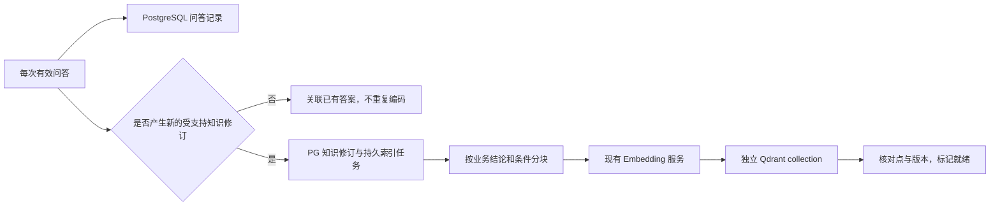

# 知识库类型、代码配置与问答索引

这是待实现的页面和数据合同，延续同一 Agent、检出目录共享读取/独占更新方案；本轮只更新 OpenSpec。

页面字段对应的 PostgreSQL 表、版本身份、受限问答记录、增量任务和旧表删除范围见 [postgresql-schema.md](postgresql-schema.md)。源码配置随资源修订保存，目录占用与操作是实时运行状态；不能把配置 JSON 当作任务账本。

## 1. 页面入口与移除项

“新建知识资源”调整为“新建知识库”，先选择 **ONES 知识库 / 代码知识库**，再显示类型对应的配置。列表显示类型、来源、存储/索引状态及发布状态，配置编辑沿用草稿→验证→正式发布；来源类型创建后不在同一身份上直接切换，避免混用权限和内容。

移除页面顶层旧“代码业务知识”面板及其重复配置入口，明确移除“已登记源码快照”“mes-code · SVN 与更新计划”、提取应用/服务账号、基线提取和整包候选发布。SVN 浏览/检出能力移到代码知识库的“源码”配置中，保留文件/文件夹多选、完整检出和任务状态，不删除已有检出文件。

共用服务运维区继续展示 Qdrant、Embedding、重排等状态；文案不得固定为“三个 ONES 知识库”，停止共享服务的影响须覆盖已使用该服务的代码知识库。ONES 采集计划和补采仅在 ONES 上下文展示，代码库不出现 Team、本人 ONES 身份提示或 ONES 同步日期表单。

## 2. 创建与编辑代码知识库

| 配置组 | 字段和行为 |
|---|---|
| 基本信息 | 名称、编码、类型=代码知识库；可从空内容库开始创建，不要求先选已入库 KB |
| SVN 来源 | 仓库地址、分支/相对路径、凭据引用；保存的是受控来源配置，账号密码不嵌入 URL。管理员可登记/验证地址，Agent 不能传任意地址 |
| 检出目录绑定 | 选择与仓库 UUID/分支相符的已完成检出任务，显示实际范围、当前 SVN revision、目录和读写占用；也可在当前配置里浏览、多选和新建检出，完成后显式绑定 |
| PostgreSQL | 选择已登记的受管内容目标，默认复用现有平台 PostgreSQL；显示数据库/knowledge schema 和连接验证结果，不把 ONES 的只读外部连接直接作为自动写回目标 |
| Qdrant | 选择现有受管 Qdrant 目标，为本代码 KB 配置/初始化独立 collection，校验维度、距离度量、索引身份及凭据引用；不选择或覆盖 ONES 集合 |
| 分块与 Embedding | 选择兼容的分块 profile 与现有 Embedding profile；文档编码和查询编码须匹配模型/维度/profile，保存并显示具体 profile 身份 |
| 增量索引 | 默认开启，答案新增/修订后自动分块与编码；显示待处理/处理中/就绪/失败及重试，不触发源码预提取。显式暂停只积累待处理记录，不丢失已保存答案 |
| 重排 | 默认复用现有 knowledge-reranker，显示固定 profile/可用状态；无需为每个代码 KB 部署模型服务 |
| 版本查询策略 | 用户必须提供 SVN 数字版本；先相等版本，缺适用证据再取最近更高版本作线索，并核验原目标版本。展示固定策略，不配置偷偷覆盖用户版本的默认值 |

首期复用已部署、已登记且由平台管理的 PostgreSQL/Qdrant，配置绑定到受管目标，而不是引入任意外部库自动建表/写入功能。既有 ONES 自定义外部内容连接仍按原只读合同工作；读连接验证成功不证明代码答案可以写入。

创建草稿可先保存未完成配置；发布前须有合法源码/checkout 绑定、可写受管存储、兼容 Embedding/分块配置和可检索的增量 collection。显式“初始化索引并验证”允许建立该代码 KB 的空集合，零答案不是验证失败。初始化幂等，只能作用于本 KB 的登记目标；不会覆盖其他集合、自动执行外部 DDL 或扩大用户授权。新答案就绪不需要重新发布。

仓库地址/分支与选择的 checkout 不匹配时阻止验证；不允许任意本地路径或手工更改版本标签。多个 KB 若确实绑定同一个 checkout，必须复用同一个受管目录身份和锁记录，不能重复登记绕过互斥。配置重绑须排空受影响分析或拒绝修改，不能在分析期间换路径；更换仓库/分支不改写历史答案来源。

## 3. 用户版本与两阶段检索

用户提问必须携带明确数字 `svn_revision=N`（表单字段或对话中明确给出）。没有数字时提示补充，不能用工作副本当前版本、现场绑定、默认配置或 HEAD 悄悄代替。代码类 knowledge_search 缺此参数应返回 SVN_REVISION_REQUIRED，不先花费检索/分析预算。

1. **相等版本**：在当前 KB、仓库 UUID、分支、权限、当前知识修订及就绪索引范围内，使用 `svn_revision=N` 硬过滤，再向量召回和重排。证据足够且条件适用则直接使用完整答案。
2. **最近更高版本线索**：仅当前成功检索无适用证据时允许。由 PG 在同一来源/权限范围的已就绪知识版本中选择最小 `revision>N` 为 R；只对 R 做一次检索，不无限扫描所有更高版本。若 R 没相关线索则直接查 N 的源码。版本相近不代表规则相同，响应显示 N、R 及差值。
3. **核验原版本**：较高版本结果标为 `higher_revision_hint` 和 `requires_verification=true`；当前 Agent 使用 N 的工作副本验证关键条件、动作及失败路径，确认后才回答并生成 N 的知识。没有权限、代码不可得或证据不足时明确不能确认，不降级直接返回 R 的规则作为 N 的答案。

Knowledge MCP 使用固定 `version_mode=exact/next_higher_hint`，模型不能注入任意过滤表达式。后者关联同 Job 的成功 exact search_id 和缺证据理由，服务器检查 KB/问题/用户目标版本一致；下一版本由服务端选择，前置故障不得触发回退。两个阶段共用原请求截止和总预算。

所有结果包含 requested_revision、matched_revision、match_kind、requires_verification 和证据支持状态。源码 update 的目标始终是 requested_revision，不得因为匹配 R 而切到 R。较高版本候选与相等版本候选分阶段返回，不能混在一个排序列表让高分替代版本优先级。权限、来源、版本先过滤再重排；无较高版本时不自动尝试较低版本或 HEAD。

例如用户问 r100，库里只有 r101“字段 A 可以为空”：系统先将其作为线索，再检查 r100；若 r100 实际要求 A 非空，最终回答和新缓存保存 r100 的规则，r101 原记录保留。

## 4. 每次问答记录与增量知识

每个携带有效 SVN 版本并产生业务回答的代码问答，都由宿主在结果收尾时幂等保存一条受限问答记录：Job/结果修订、KB、规范化问题、允许持久化的业务答案、用户目标 SVN、实际引用知识版本、证据/支持状态和时间。缓存命中也记录，不依赖模型记得调用保存工具；不复制原始聊天、凭据或私有实例到共享知识。缺版本的澄清不伪造带版本业务答案。

用户明确比较两个版本时，分别检索/核验两个数字版本，问答记录保留两个目标和各自结论；分版本知识仍分别存储，不能把比较结论伪装为某一版的无条件规则。

问答记录与可检索知识分开：同版本命中只关联已有答案/知识修订，不再次造文档、分块或调用 Embedding。首次代码核验或同版本实质纠错仍通过 knowledge_save_code_answer 验证并形成知识修订；新知识带用户请求的 N，较高版本 R 仅记为线索来源。partial/conflicted/仅有更高版本线索的记录留存，但不进入确定答案索引。

分块保留问题、结论、适用条件和必要上下文；拆分长答案时每块带适用范围，不能把例外与结论拆开后误答。每块关联 KB/document/revision/chunk/profile、仓库 UUID/分支/SVN revision、支持状态及证据引用。向量点使用确定身份，来源/权限/版本 payload 由服务端生成，模型不能自行标成其他版本。

PG 先保存，Worker 再按新增或修订知识增量生成 chunk→Embedding→Qdrant；每次请求的日志记录不触发整库索引。重试幂等，部分块失败时不把该修订标就绪；同版本纠错使旧知识修订退出候选，不删除其他 SVN 版本。索引失败保留 PG 内容与可重试状态；PG/记录失败不伪称已保存，也不为了补记录重跑模型。

模型、维度或分块 profile 改变属于显式索引配置变更，需要准备兼容索引并验证切换，不能将新旧向量混入同一声明 profile；普通新答案不重新发布或重建全库。

## 5. 共用重排服务的范围

已核对当前代码：rerank_contract.py 的请求只有 profile_hash/query/documents，code_search.py 已使用传入的 RerankPort，KnowledgeSearch 将同一 reranker 传给代码分支。因此可复用现有服务、模型 profile、有界队列和超时合同；现有代码分支调用不证明新问答知识链路已实现。

共享的是模型服务，不是 ONES 数据集合或授权。两类检索分别生成经过来源/权限/版本过滤的候选，再送入重排；重排分数不决定版本是否匹配，也不证明规则正确。两类请求共享容量，沿用有界候选/排队/截止与忙错误，故障不能当无答案去触发源码分析。实施验收比较代码业务答案的召回/重排效果，并验证两类并发不会造成不可接受的超时；本方案不因复用自动增配容器或改动模型参数。
