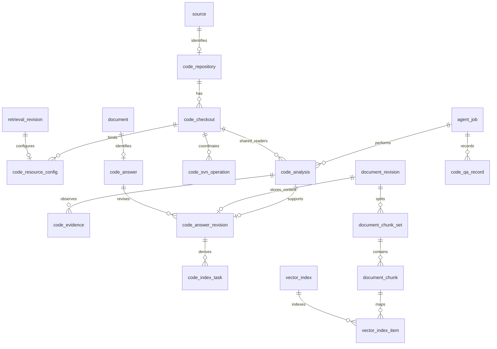

> 实施状态（2026-11-09）：用户已调用 openspec-apply-change 授权实施。以下“仅设计／不改代码”等描述是此前提案阶段的边界；本轮实施进度与验证以 tasks.md 和 implementation-evidence.md 为准，尚未部署的设计不视为线上能力。

# PostgreSQL 代码知识库表结构重设计

状态：待实现设计，2026-11-09。本文件依据迁移 131–159 中相关 PostgreSQL DDL 和当前增量处理代码核对，不代表已查询生产数据库或执行迁移。沿用“只更新 OpenSpec”；旧代码候选无须兼容，ONES、共享平台数据和已有检出文件保留。

## 1. 存什么，以及不再存什么

新的知识单元是“某仓库、某分支、某 SVN 版本下，有条件、有证据的业务问题答案”。不再预先拆出全量工单/处方/物料状态机、生成候选快照或每日重建整库。跨模块关系记录在具体答案的条件、结论、覆盖范围和代码证据中；当前不增加通用图、实体目录或关系推理系统。

三种版本必须分开：

| 名称 | 例子 | 身份和作用 |
|---|---|---|
| 源码版本 | SVN r100、r101 | `source_id + svn_revision`；source 固定仓库 UUID/分支。不同 SVN 版本是不同 document |
| 答案内容修订 | r100 的第 1 次解释、第 2 次纠错 | 同一 document 下的 `document_revision.revision_no`，不覆盖 r101 |
| 资源配置修订 | 更换分块/Embedding 配置 | 沿用 `retrieval_revision`；普通答案入库不重新发布资源 |

每次问答都保存受限记录；只有经代码证据核验的新知识才生成可索引文档。重复命中只增加问答记录。PostgreSQL 是事实源，Qdrant 仅保存派生向量与受控检索元数据，不能反过来决定版本、权限和答案有效性。

## 2. 表清单与边界

保留现有 `knowledge.source`、`knowledge.knowledge_base`、`knowledge.document`、`knowledge.document_revision`、`knowledge.knowledge_base_document`、`knowledge.document_chunk_set`、`knowledge.document_chunk`、`knowledge.vector_index`、`knowledge.vector_index_item`，以及资源草稿/验证/发布、平台 Job/invocation/MCP 审计。ONES 的 import/sync/relation/source_binding 表继续服务原流程。

代码专用部分收敛为以下 **10 张表**；旧表处理见第 8 节。全部位于 `knowledge` schema，不另外建数据库，不复制通用文档与索引层。

| 表 | 一行代表什么 | 生命周期 |
|---|---|---|
| `code_repository` | 一个已确认的仓库 UUID + 分支来源 | 稳定来源身份 |
| `code_resource_config` | 一份代码检索资源配置修订 | 随现有草稿/发布版本保存 |
| `code_checkout` | 一个受管的真实工作副本目录 | 可更新目录与唯一锁身份 |
| `code_svn_operation` | 一次浏览、检出、update 或历史查询请求 | 执行、幂等、恢复审计 |
| `code_analysis` | 原 Job 在一个版本的一段分析，同时承载自己的读占用 | 领取、阅读、核验、停止、释放 |
| `code_evidence` | 本次分析实际取得的一项文件/历史证据 | 受控元数据，随分析保留 |
| `code_answer` | 一个确定 SVN 版本的问题/条件身份 | 对应一条共享 document |
| `code_answer_revision` | 该答案一次通过证据核验的内容修订 | 对应一条 document_revision |
| `code_qa_record` | 一次带版本的最终业务回答 | 受限问答历史，不自动索引 |
| `code_index_task` | 一个索引中某内容修订的增量写入或清理 | PG 事务任务、Worker 恢复 |



以下字段名是实施合同。ID 沿用项目 `TEXT`，SVN revision 用 `BIGINT CHECK >= 0`，时间用 UTC `TIMESTAMPTZ`，布尔用 `BOOLEAN`，摘要用 `TEXT CHECK length=64` 并校验 SHA256 格式。`?` 表示可空，未标注者必填；JSONB 用于有界、带 schema 的结构，不能代替版本、外键、状态和队列字段。所有表列需中文注释。

## 3. 配置、工作副本和分析表

### 3.1 `code_repository`：来源身份

| 字段 | 类型 / 约束 |
|---|---|
| `source_id` | TEXT PK、FK → source.id |
| `repository_uuid` | UUID，来自真实 SVN info |
| `branch_path` | TEXT，仓库根相对规范路径，根用空串 |
| `repository_root_url` | TEXT，经受管登记验证的根 URL，不含 userinfo/凭据 |
| `verified_at`, `created_at` | TIMESTAMPTZ |

`UNIQUE(repository_uuid, branch_path)`；source 必须 `source_system=svn`、`origin_state=verified`。UUID/branch 一旦确认不可原地改写；换来源创建新 source，历史答案仍指向旧 source。根 URL 可在验证 UUID 不变后调整访问端点；凭据不存这里。没有 commit 全量账本、已采集 revision 或全局“当前开发快照”。

### 3.2 `code_resource_config`：代码类型的配置扩展

| 字段 | 类型 / 约束 |
|---|---|
| `revision_id` | TEXT PK、FK → retrieval_revision.id |
| `source_id` | TEXT?、FK → code_repository.source_id，未完成草稿可空 |
| `checkout_id` | TEXT?，与 source_id 组成 FK → code_checkout(id, source_id) |
| `svn_access_ref` | TEXT?，既有受管 SVN 登记项/凭据引用，禁止密码/Token |
| `allowed_paths_json` | JSONB，来源相对路径的有界授权子集 |

同一个 source 可供多个 KB 使用，同一 checkout 可被多个配置引用，不再施加旧 `code_binding` 的 source→唯一 KB 限制。`checkout_id IS NULL OR source_id IS NOT NULL`。发布验证要求 source、checkout、访问引用齐备、类型匹配且路径是实际检出范围的子集。

PostgreSQL/Qdrant 目标、Embedding/重排 profile 与连接引用只在现有 `retrieval_revision.storage_config_json` 的代码类型 schema 中保存，不能在这里再建一套可漂移的连接配置。`retrieval_revision.index_id` 指向本 KB 的受管 `vector_index`，其 profile/collection 是索引执行的固定配置。草稿允许 index 尚未初始化，发布前必须齐备。现有 config_hash 包含上述类型扩展与目标/profile 摘要。

### 3.3 `code_checkout`：目录与写者

| 字段 | 类型 / 约束 |
|---|---|
| `id` | TEXT PK |
| `source_id` | TEXT FK → code_repository.source_id；`UNIQUE(id, source_id)` |
| `root_key`, `relative_dir` | TEXT，部署登记根 ID + 根下目录；不存 Mac/Windows 绝对路径 |
| `physical_key` | TEXT? UNIQUE，执行器验证的规范真实工作副本身份摘要；初次检出仅预留目录时为空，ready 必须非空 |
| `selected_paths_json` | JSONB，完整检出所选文件/目录及 SVN depth，不是全文件清单 |
| `state` | TEXT CHECK：`preparing / ready / invalid / retired` |
| `verified_revision` | BIGINT?，仅 ready 可作为当前分析版本依据 |
| `generation` | BIGINT >= 0，每次取得修改权递增 |
| `writer_operation_id` | TEXT?，与 id 组成 FK → code_svn_operation(checkout_id, id)，可延迟检查 |
| `verified_at`, `invalid_reason` | TIMESTAMPTZ?、TEXT? 安全错误码 |
| `created_at`, `updated_at` | TIMESTAMPTZ |

`UNIQUE(root_key, relative_dir)`；ready 要求 verified_revision/verified_at 非空。登记在部署根范围内串行核对真实路径、大小写/符号链接别名及祖先/子路径重叠，不能仅靠字符串 UNIQUE。不同根映射到同一物理目录也拒绝重复登记。代次属于目录写操作，新增读者不能递增它或使已有读者失效。

不保存 `reader_count` 作为准入事实；直接查询 code_analysis 未释放占用，避免计数与占用记录不一致。writer 的 owner、心跳、截止统一存在 operation 表，不在目录重复一份租约。

### 3.4 `code_svn_operation`：统一 SVN 持久操作

替代旧 code_checkout_job；浏览/检出和新增 update/log/diff/info/blame 共用一张表，继续由 knowledge-sync 执行，不创建模型 Job。

| 字段 | 类型 / 约束 |
|---|---|
| `id` | TEXT PK |
| `source_id` | TEXT? FK → code_repository.source_id；仅首次管理 browse 在尚未成功时可空，问答/检出及成功浏览必须有已验证来源 |
| `checkout_id` | TEXT?，与 source_id 复合 FK → code_checkout；`UNIQUE(checkout_id, id)` |
| `analysis_id` | TEXT?，与 checkout_id/source_id 复合 FK → code_analysis；分析操作必填 |
| `job_id`, `invocation_id` | TEXT?，当前问答执行引用；管理端 browse/checkout 可空 |
| `actor_id`, `config_revision_id` | TEXT FK → app_user、TEXT FK → code_resource_config.revision_id |
| `operation_kind` | TEXT CHECK：`browse / checkout / info / update / log / diff / blame / repair / retire` |
| `request_key`, `request_hash` | TEXT UNIQUE、SHA256；key 由服务器绑定调用者/Job/调用身份，同 key 不同参数拒绝 |
| `state` | TEXT CHECK：`queued / running / succeeded / failed / interrupted / cancelled` |
| `target_revision`, `from_revision`, `to_revision`, `peg_revision` | BIGINT?，按操作类型校验必填和范围 |
| `request_json` | JSONB，受控路径、日期边界、分页和固定参数；不含任意命令 |
| `result_json`, `result_hash` | JSONB、SHA256?；有界结构化元数据及摘要，不持久化原始 diff/源码/提交消息 |
| `checkout_generation` | BIGINT?，修改和分析操作绑定执行代次 |
| `owner_instance_id`, `claim_version` | TEXT?、BIGINT >= 0，执行器归属与重试写入栅栏 |
| `lease_until`, `deadline_at`, `started_at`, `quiesced_at`, `finished_at` | TIMESTAMPTZ?；准入后 deadline 必填，quiesced 表示确认子进程已停止 |
| `error_code`, `created_at`, `updated_at` | TEXT?、TIMESTAMPTZ、TIMESTAMPTZ |

初次 browse 只绑定当前草稿和受管访问项，Worker 通过真实 SVN info 核实后登记 source 并完成操作；不能为了创建浏览操作预先伪造已验证来源。checkout 使用成功浏览的来源，先预留 preparing 目录和写权，真实目录创建后核实并补齐 physical_key，成功后才能绑定并发布。用户不能靠填写 UUID 或文件系统身份冒充已验证结果。repair/retire 只允许已有管理控制面，不向 Agent 暴露通用维护命令。

### 3.5 `code_analysis`：一次分析兼一个读占用

| 字段 | 类型 / 约束 |
|---|---|
| `id` | TEXT PK |
| `job_id`, `invocation_id`, `owner_instance_id` | TEXT，引用现有 agent_job / agent_runtime_invocation，owner 从已确认 Runtime 执行身份派生 |
| `knowledge_base_id`, `config_revision_id` | TEXT FK → knowledge_base / code_resource_config |
| `checkout_id`, `source_id`, `requested_revision` | TEXT、TEXT、BIGINT，复合 FK → code_checkout(id, source_id) |
| `request_key`, `request_hash` | TEXT UNIQUE、SHA256；幂等申请/保存 |
| `exact_search_id`, `question_hash`, `authorization_hash` | TEXT、SHA256、SHA256；关联同 Job 成功 exact 检索和冻结的权限上限 |
| `state` | TEXT CHECK：`preparing / reading / validating / completed / partial / conflicted / failed / cancelled` |
| `generation` | BIGINT?，与准入时 checkout 代次一致 |
| `read_acquired_at`, `read_revoked_at`, `reads_quiesced_at`, `read_released_at` | TIMESTAMPTZ?，停止新调用、实际停止与释放分开 |
| `lease_until`, `deadline_at` | TIMESTAMPTZ?，占用生效前必须设置；受 Job 总截止约束 |
| `saved_revision_id` | TEXT? FK → code_answer_revision.revision_id，可延迟检查；新建或幂等复用的知识修订 |
| `save_request_hash` | SHA256?，防同一分析不同内容伪装成保存重放 |
| `report_json` | JSONB，脱敏的条件、覆盖、未知项、partial/conflicted 结论；不存整段对话 |
| `closed_at` | TIMESTAMPTZ?，相关读调用和 SVN 执行均确认停止、占用已释放后才能关闭 |
| `error_code`, `created_at`, `updated_at` | TEXT?、TIMESTAMPTZ、TIMESTAMPTZ |

`UNIQUE(id, checkout_id, source_id)`；Job/invocation 配对需复合 FK（在现有 invocation 增加对应 UNIQUE），不能分别指向两个不相关执行。`read_released_at` 非空必须已有 reads_quiesced_at；**占用是否阻止写入以 acquired 非空且 released 为空为准**，不以 state、lease 到期或 Job 逻辑终态为准。preparing 虽尚无读占用，仍受同 Job 单次分析准入约束；单 Job 不得并发申请两个目录或持读升级。

exact_search_id 复用现有 MCP 调用审计 ID，在安全审计详情中记录 KB、问题摘要、N、版本模式、成功状态及有界结果身份；读取原记录复核，不信任模型传入“已查无结果”。不另建搜索日志表；审计保留期至少覆盖当前 Job/分析恢复期限，缺失时要求重新检索。

### 3.6 `code_evidence`：代码与历史依据

| 字段 | 类型 / 约束 |
|---|---|
| `id`, `analysis_id` | TEXT PK、TEXT FK → code_analysis |
| `kind` | TEXT CHECK：`file_read / svn_history` |
| `relative_path`, `symbol`, `line_start`, `line_end` | TEXT?、TEXT?、INTEGER?、INTEGER?；file_read 必须路径和有效行范围 |
| `svn_revision`, `peg_revision` | BIGINT、BIGINT?；文件证据必须与 analysis.requested_revision 一致 |
| `repository_content_hash`, `read_content_hash` | SHA256?，分别核对仓库字节和模型实际看到的文本表示；文件证据必填 |
| `representation_json` | JSONB，编码、EOL、SVN keyword 及行号映射的明确格式；无法可靠映射则不准入确定知识 |
| `tool_call_id`, `operation_id` | TEXT、TEXT? FK → code_svn_operation；绑定真实 Read/Grep 或历史调用 |
| `from_revision`, `to_revision`, `result_hash` | BIGINT?、BIGINT?、SHA256?；历史证据记录端点和结构化结果摘要 |
| `evidence_hash`, `observed_at`, `validated_at` | SHA256、TIMESTAMPTZ、TIMESTAMPTZ? |

`UNIQUE(analysis_id, evidence_hash)`。代码证据来源由宿主登记，模型只引用 ID，不能自报 hash/已读证明。历史路径集等有界参数从 operation 取得；log/diff 不单独证明完整业务规则。每条答案的结论仅引用同 analysis 的、实际返回给该调用者且保存前核验过的 evidence ID，事务内检查引用覆盖，不把“文件存在”当成“读过所引用内容”。

不永久保存源文件正文或全仓清单。必要旧证据通过 SVN 指定 revision 重取；该表的哈希与位置是证据索引，并非源码副本。

## 4. 答案、问答记录与索引任务

### 4.1 `code_answer`：稳定知识身份

| 字段 | 类型 / 约束 |
|---|---|
| `document_id` | TEXT PK、FK → document.id |
| `source_id` | TEXT FK → code_repository.source_id，与 document.source_id 必须一致 |
| `svn_revision` | BIGINT，一个明确数字版本，不用生效区间猜测适用性 |
| `question_text`, `question_hash` | TEXT、SHA256，已脱敏的规范化业务问题及摘要 |
| `conditions_json`, `conditions_hash` | JSONB、SHA256，明确配置、对象/操作等适用条件，不含现场私有实例值 |
| `visibility_scope_json`, `visibility_scope_hash` | JSONB、SHA256，由平台授权逻辑生成的可共享业务/路径范围 |
| `identity_hash` | SHA256，规范化规则版本 + question/conditions/visibility 摘要 |
| `created_at` | TIMESTAMPTZ |

`UNIQUE(source_id, svn_revision, identity_hash)`。document 取 `document_kind=code_answer`、`source_object_type=code_answer`、`external_id=稳定编码(svn_revision, identity_hash)`；保留通用来源身份唯一约束，增加 `(id, source_id)` UNIQUE 供复合 FK，不以 KB/checkout/analysis ID 生成知识身份。

question_hash 只做确定的文本规范化，向量相似不构成数据库唯一性依据。相似表述优先复用检索命中；修正已有答案必须提交明确 document ID 和预期 current_revision_id，通过当前授权与条件检查后 CAS 更新。同 hash 冲突仍比较规范字段，不能静默合并；新条件、不同可见范围应生成不同身份。可见范围哈希不是授权凭据，检索仍执行当前权限检查。相同知识可通过 knowledge_base_document 收录到多个合法 KB。

### 4.2 `code_answer_revision`：证据核验通过的答案修订扩展

| 字段 | 类型 / 约束 |
|---|---|
| `revision_id` | TEXT PK、FK → document_revision.id |
| `document_id` | TEXT FK → code_answer.document_id；与 revision_id 复合 FK → document_revision(document_id, id) |
| `claims_json` | JSONB，有界数组：claim_id、结论、适用条件、evidence_ids；跨模块依赖体现在结论及引用中 |
| `coverage_json`, `unknowns_json` | JSONB，分析入口/模块、已核验范围、非关键未知项；关键未知不得进入此表 |
| `validation_version`, `validated_at` | TEXT、TIMESTAMPTZ，明确保存校验算法版本与时间 |

正文只存现有 document_revision.title/body_text，不重复 answer_text。分析来源只存 document_revision.code_analysis_id（见第 5 节），沿该 ID 关联证据；本扩展不再重复 Job、仓库、SVN 或 analysis_id。进入此表表示来源/引用校验通过且声称有充分证据，**不表示人工审批或生产现场确认**。partial/conflicted 留在 analysis/qa_record，不建立可检索代码答案修订。

修订正文、claims、coverage、证据关系保存后不可改写；纠错创建下一 revision_no。新修订提交时 document.current_revision_id 指向它，旧修订立即不再作为当前答案；如果新索引还未就绪，可出现暂时未命中，不能回退到已认定有错的旧修订。完全撤回答案将 document 标 unavailable，不靠删除审计；重新确认仍需真实证据。

### 4.3 `code_qa_record`：每次问答独立留痕

| 字段 | 类型 / 约束 |
|---|---|
| `id` | TEXT PK |
| `job_id`, `result_revision`, `knowledge_base_id` | TEXT FK → agent_job、INTEGER > 0、TEXT FK → knowledge_base |
| `actor_id`, `source_id` | TEXT FK → app_user、TEXT FK → code_repository |
| `requested_revisions` | BIGINT[]，一个版本，或显式版本比较的两个不同版本；非空、非负、无 NULL |
| `question_text`, `answer_text`, `answer_hash` | TEXT、TEXT、SHA256；仅保存允许持久化的规范化问题/业务回答 |
| `support_status` | TEXT CHECK：`supported / partial / conflicted / unverified` |
| `answer_origin` | TEXT CHECK：`cache / code_analysis / mixed / unresolved` |
| `references_json` | JSONB，逐项记录 document_id、revision_id、svn_revision、version_mode（exact/next_higher_hint）；requested_revisions 取本记录，来源分析沿内容修订关联 |
| `created_at` | TIMESTAMPTZ |

`UNIQUE(job_id, result_revision, knowledge_base_id)`；同 key 不同 answer_hash 拒绝覆盖。数组只用于单次问答的版本比较，不用于知识主键或向量过滤。references 为历史回答的有界引用记录，保存时验证 ID 及版本关系，不能从中反向授予权限。

由宿主结果收尾幂等写入，可与标准 Job 结果提交置于同一平台数据库事务；恢复根据已持久化的结果版本补记，不能依赖模型再次发送。缺 SVN 的澄清不创建该业务问答记录。该表不加入 knowledge_base_document、不分块、不编码、不对普通知识搜索开放；读取按本人/授权运维和应用 Job 可见性执行。已有缓存命中产生新记录，references 指向既有修订。

### 4.4 `code_index_task`：代码答案增量派生与清理

当前 sync_candidate 依赖 ONES sync_run/source binding、defect/ticket/requirement 类型及来源时间戳；不伪造 ONES 同步任务承载代码答案。新增这张持久任务表，复用 Worker、分块器、Embedding port、IncrementalVectorWriter 和 vector_index_item，不复制模型/向量服务或引入消息系统。

| 字段 | 类型 / 约束 |
|---|---|
| `id` | TEXT PK |
| `index_id`, `document_id`, `revision_id` | TEXT FK → vector_index、TEXT FK → code_answer、TEXT；复合 FK → code_answer_revision(document_id, revision_id) |
| `action` | TEXT CHECK：`upsert / remove` |
| `config_hash` | SHA256，固定索引/profile/受管目标身份，不随执行漂移 |
| `state` | TEXT CHECK：`queued / running / succeeded / failed / cancelled` |
| `step` | TEXT CHECK：`pending / chunked / written / verified / exposed / cleaned / done` |
| `expected_chunks`, `completed_chunks` | INTEGER >= 0，completed <= expected；向量逐项状态以 vector_index_item 为准 |
| `owner_instance_id`, `claim_version`, `lease_until` | TEXT?、BIGINT >= 0、TIMESTAMPTZ?；领取/续约及旧执行写入栅栏 |
| `attempt_count`, `next_attempt_at`, `error_code` | INTEGER >= 0、TIMESTAMPTZ?、TEXT? |
| `ready_at` | TIMESTAMPTZ?，仅 upsert 完整核验且完成可见性步骤后设置 |
| `created_at`, `updated_at`, `finished_at` | TIMESTAMPTZ、TIMESTAMPTZ、TIMESTAMPTZ? |

`UNIQUE(index_id, revision_id, action)`、code_answer_revision 增加 `UNIQUE(document_id, revision_id)`。新事实与所有应收录 KB 的 upsert 任务在同一 PG 事务提交；向其他 KB 新收录已有修订也产生该 KB 的独立任务。暂停索引仍保留任务，不影响 PG 答案保存。remove 任务负责撤回、移除收录、同版本纠错后的确定点清理，范围限该 index/revision，不能删整个集合或其他 SVN 版本。

移除后又收录同一修订，或显式修复损坏索引时，复用唯一任务行并递增 claim_version、重置相应步骤/ready_at，不能因历史 succeeded 就跳过当前期望状态核验；先排空冲突的旧 remove/upsert，固定点不存在时重建。每次派生都从当前收录与修订状态判定最终应存在的点，历史动作不能覆盖新的管理意图。

任务重试只补未完成步骤。分块复用 `(document_revision_id, profile_hash)`，向量点复用 `(index_id, chunk_id)` 确定身份；仅元数据变化/内容相同不编码。单答案包含零个可用块时失败，不能以空成功混入检索；空 KB/空 collection 则允许合法发布。任务保存 result/ready 状态不持有 checkout 读占用。

## 5. 对共享表的明确调整

| 表 | 调整 | ONES 保持的行为 |
|---|---|---|
| `knowledge_base` | 增加不可直接互换的 `kind TEXT CHECK IN ('ones','code')`；增加 `code_indexing_paused BOOLEAN DEFAULT false`，仅代码库可设 true | 旧 ONES 按经核对来源归类，不从名称猜测；原 state/权限/收录保留 |
| `document` | document_kind 去掉旧代码专用 object/state_machine/state/operation/rule/transition，加入 code_answer；增加 `(id, source_id)` UNIQUE | defect/ticket/requirement/article 原约束、稳定外部身份保留 |
| `document_revision` | 增加 `origin_kind ('import','code_analysis')`、`code_analysis_id TEXT? FK`；import_run_id 改可空；CHECK 两种来源恰选一种，code_analysis_id 对非空值 UNIQUE；source_project_id/name 改可空，代码修订禁止伪造 ONES project | import 来源仍必须有 import_run_id、原项目字段；code 来源必须有 code_analysis_id 且 import_run_id/project 字段为空；同一分析最多生成一个新答案修订 |
| `document_revision` | code 来源的 source_snapshot 只保留 source/SVN/分析元数据，attributes/completeness 保留已有通用业务语义；新增字段不复制原始聊天或工程 | 不删除 ONES 的 source_snapshot、source_status、时间戳和 attributes；这些并非废弃“源码快照”列 |
| `document_chunk` | 增加 `chunk_kind=business_answer`，对应 body_text；增加 `context_json JSONB DEFAULT '{}'`，保存代码条件摘要与 claim/evidence 引用 | problem/solution 与既有 source_field 对应关系和长度/offset/hash约束保留；代码上下文不得塞进质量标志冒充质量信息 |
| `retrieval_revision` | index_id 允许未完成草稿为空；config schema 增加 code 类型（沿现有 configuration_version 机制），代码 binding_id 为空；code_resource_config 作为扩展一起算 config_hash | 发布验证仍必须完整且索引就绪；保留原 ONES 历史 binding_id、外部只读 storage_config_json 合同 |
| `vector_index` / `vector_index_item` | 复用当前已支持零计数、incremental 和单块状态的结构，代码索引 source_id 必填、sync_run_id 为空；collection 独占于当前 KB/index/profile | 不新增第二套 chunk/vector 表，不改变 ONES sync_run 所有权 |
| `agent_runtime_invocation` | 增加 `(job_id, invocation_id)` UNIQUE 供代码分析复合 FK | 复用既有 owner/lease/execution_quiesced_at，不替代其执行调度 |

来源类型与扩展表的对应、版本与证据一致性属于事务内必检不变量；在可表达处使用复合 FK/CHECK，其余在唯一受控写入口验证并做迁移/并发测试。禁止开放模型 SQL 绕过该入口。JSONB 检查至少包括顶层类型、字段白名单、数量/长度、条件与 claim ID 的一致性；不采用通用动态 EAV 或每字段一张表。

## 6. 必需索引和事务规则

### 6.1 索引

除 PK/UNIQUE 自动建立索引外，实施以下有调用者的索引；不预先对所有 JSONB 建 GIN：

| 表 | 索引 | 服务的查询 |
|---|---|---|
| code_answer | `(source_id, svn_revision, document_id)` | 相等版本、最近更高版本；source 固定 UUID/分支 |
| knowledge_base_document | `(document_id, knowledge_base_id) WHERE state='included'` | 某答案需要派生的 KB、收录核验；保留原 PK |
| code_analysis | `UNIQUE(job_id) WHERE closed_at IS NULL` | 一个 Job 同时一段活动分析，包含 preparing |
| code_analysis | `(checkout_id, requested_revision) WHERE read_acquired_at IS NOT NULL AND read_released_at IS NULL` | 活动读者，包括超时但未确认停止者 |
| code_analysis | `(lease_until) WHERE closed_at IS NULL` | 有界恢复扫描，不代表直接释放 |
| code_svn_operation | `(state, created_at, id)`；`(checkout_id, created_at)` | 领取/恢复与目录操作历史 |
| code_evidence | `(analysis_id, kind)` | 保存时核验证据及历史详情 |
| code_qa_record | `(actor_id, knowledge_base_id, created_at DESC)` | 受限问答历史 |
| code_index_task | `(state, next_attempt_at, created_at)`；`(index_id, revision_id) WHERE action='upsert' AND ready_at IS NOT NULL` | 待执行任务、就绪候选 |
| code_index_task | `UNIQUE(index_id, document_id) WHERE state='running'` | 同一索引/文档的 upsert 与 remove 不并发 |

source/KB/FK 经真实查询 EXPLAIN 再补需要的索引，不能为“以后也许查询”铺满索引。普通查询只检查有界候选及相关来源，不扫描全部文档/点；额外索引是否有效属于实施时验证，不假称本设计已完成压测。

### 6.2 并发读写与关闭

1. 领取同版本读占用、申请写者、释放、写转读，统一在短事务中锁 `code_checkout` 行（`SELECT ... FOR UPDATE`），跨 Job 准入同时锁其 agent_job 行。固定加锁顺序先 Job、再 checkout；纯管理动作只锁 checkout。检查 active reader 必须使用 acquired/released 字段，不过滤到期租约。
2. 已是 N 且无 writer：插入 reading analysis，记录代次，提交后执行只读核对；核对前不发 grant。需要 update：仅无活动读者且 writer 为空才原子设置 writer_operation_id/递增代次；长 SVN 调用在事务外执行，不能长时间占数据库行锁。
3. 成功 writer 核验后，在同一 checkout 事务中设置 verified_revision=N、插入/启用自己的读占用并清空 writer；响应丢失按 request_key 返回原 analysis，不重复计数。
4. 保存或取消时先 revoke 自己的新调用并等待自己的在途读取/子进程停止，再在事务内记 reads_quiesced_at/released_at/closed_at。逻辑终态与实际停止时间分开；不确定就保留占用，禁止凭 lease 过期夺锁。
5. writer 失联也保留 writer_operation_id；恢复核对执行器实例与子进程停止，旧 claim_version 不能再写状态，确认停止后才能解除写占用。准备失败但仍有子进程时 analysis.closed_at 也保持空，不能提前重试另一个目录。

普通数据库约束不能独自表达“另一个表不存在读者”；必须有上述所有入口共用的事务协议。grant 只是有效读占用的派生短期能力，不新增存明文 Token 的表。

### 6.3 保存、纠错与 Qdrant

保存事务锁定 code_answer/document（新身份通过 UNIQUE 竞争），校验 expected_current_revision、条件/权限、当前分析、真实证据和 save_request_hash。相同内容重放关联原 revision；实质修改插入 document_revision + code_answer_revision，更新 current_revision_id、收录、索引任务和 analysis.saved_revision_id。代码内容不伪装成 import_run；已提交但响应丢失可在占用释放后返回原保存结果。

纠错使旧 revision 不再是 current，同时为旧点登记 remove。Worker 在写点前、核验就绪前检查任务身份/profile/当前修订与收录。更新期间落后的任务取消并清理自己的点，不能覆盖新修订。所有点创建时检索可见标记关闭；整篇核验通过后才 expose，再提交 PG ready_at。两系统无分布式事务：中间故障通过确定 point ID 和持久步骤恢复，查询同时校验 Qdrant 标记与 PG 当前就绪事实。撤回后即使旧点暂未清理也不能作为答案。

claim_version 同时进入代码向量 point ID 与 payload 的 index_generation_key，PG 当前 succeeded/ready 的代次决定可检索集合，并在向量召回前过滤。旧进程恢复仍必须取得对应文件锁、核对 owner/claim 停止证明；这只证明本地调用停止，不等于远程 HTTP 已取消。迟到 upsert/expose 只能影响旧代次点；remove 捕获该 upsert 任务的最高代次并按此上限删除，不能删除以后重新收录的点。重试最多检查前 8 个代次的不可变向量，验证后复制到新代次，响应丢失时避免重复 Embedding。更早的残留点可能等待后续清理，但不能参与召回。cleanup 与 upsert 仍按同 index/document 串行准入，不另建分布式锁服务。

## 7. 精确版本与最近更高版本如何查询

PG 的准入集合必须同时满足：当前已发布代码配置、当前 KB/source 授权、included 收录、document active、当前 revision、代码证据校验合格、指定索引的 upsert ready_at 非空、索引/profile 兼容。个人不可见或未就绪的 r101 不能决定他人的“最近更高版本”。可见范围由受控参数/授权逻辑约束，不能只做 Qdrant 过滤后假设全部可信。

下列是**查询形状**，`:authorized_document_scope` 表示服务端在同一来源授权上下文生成的受限条件，并非接收用户 SQL，也不是需物化的全库临时表：

```sql
SELECT MIN(a.svn_revision) AS next_revision
FROM knowledge.code_answer a
JOIN knowledge.knowledge_base_document m
  ON m.document_id = a.document_id AND m.knowledge_base_id = :kb_id
JOIN knowledge.document d ON d.id = a.document_id
JOIN knowledge.code_answer_revision ar
  ON ar.document_id = d.id AND ar.revision_id = d.current_revision_id
JOIN knowledge.code_index_task t
  ON t.index_id = :published_index_id AND t.revision_id = ar.revision_id
WHERE a.source_id = :authorized_source_id
  AND a.svn_revision > :requested_revision
  AND m.state = 'included' AND d.lifecycle_state = 'active'
  AND t.action = 'upsert' AND t.ready_at IS NOT NULL
  AND t.state <> 'cancelled'
  AND /* server-owned scope predicate */ :authorized_document_scope;
```

这是第二阶段选版本，执行前已检查 index READY、profile/配置、同 Job 成功的 exact search_id 和缺证据原因。第一阶段对 `svn_revision=N` 精确过滤召回，第二阶段只对返回的最小 R 检索一次；选出的 R 没相关结果就核验 N，不继续尝试 R+1。过滤范围不可直接展开成全库 document ID 列表；按已登记可见范围生成受控 SQL/payload 条件，命中后再次核验 PG/授权。

Qdrant payload 由宿主设置 KB/source、UUID/branch、svn_revision、document/revision/chunk、index/profile、可见范围标识和 evidence 引用。大段条件/证据正文保留 PG，分块 embedding_text 只放检索必要上下文。每块条件与结论必须同读，不容许只拿脱离条件的一段正文作答。

| 数据 | 用户问 r100 时的行为 |
|---|---|
| r100 当前答案已就绪 | 直接核对条件后回答，新增 QA 记录，不编码 |
| 只有 r101“字段 A 可为空” | 返回 r101 线索 + requires_verification；去读 r100 |
| r100 代码显示 A 必填 | 新建 r100 document/revision/证据/索引任务，r101 原知识保留 |
| 后来发现 r100 解释漏了配置开关 | r100 同 document 的下一 revision；旧 r100 退出检索，r101 不受影响 |
| r100 无权访问、目录忙或依赖失败 | 记录实际限制，不将 r101 标成已验证 r100 |

## 8. 删除与保留清单

本次核对迁移 154、155、156、159 的 PostgreSQL 定义。以下 **19 张预提取/状态机表删除**，无需搬迁为新答案：

- 旧配置/构建：`code_binding`、`code_commit`、`code_build`、`code_unit`、`code_demand`。
- 快照/成员/依赖：`code_source_snapshot`、`code_source_file`、`code_snapshot`、`code_member`、`code_relation`、`code_dependency`、`code_history_check`。
- 状态机明细：`code_object`、`code_machine`、`code_event`、`code_state`、`code_transition`、`code_transition_source`、`code_transition_failure`。

`code_checkout_job` 也退出最终 schema，浏览/检出改由 code_svn_operation 承担，合计退役 **20 张代码旧表**。旧已完成目录不删除、不搬动；停旧写者后执行一次只读登记核实，生成 code_repository/code_checkout，必要时保留安全的旧操作 ID/状态摘要在迁移审计中。此步骤只是登记现有工作副本，并非兼容旧候选或补造一次成功的新操作。

不在旧 code_binding 上继续打补丁；其 `demand_enabled/collected_revision/collected_from_revision/active_snapshot_id/next_run_at/operations_json/collection_json` 随整表退出。新代码来源没有每日提取/现场默认 SVN 号/默认版本自动补齐字段。

共享表**仅删除清单明确属于旧代码源/候选的行**：旧代码 document/revision/收录、代码专属 chunk/index/item、代码专属 import_run、旧代码资源草稿/验证/发布引用。清点必须覆盖这些表的实际 FK、软引用和旧 Agent/Application 工具发布；先让旧代码资源不可用并排空任务，不能把失效旧发布留在可用目录。ONES/其他来源的行、应用与 Job/audit 历史保留；共享来源有混合收录时先报出引用，禁止按名称前缀一刀切。

保留现有 source/knowledge_base 的稳定 ID，只对已核实的旧代码来源重新登记 SVN 身份和新配置；无法证明 UUID/分支对应则新建 source，不猜映射。历史已完成 Job 可以保留原冻结内容，但不会获得新权限或触发旧代码路径。

禁止删除共享 `document_revision.source_snapshot`、import/sync 表、document_relation、retrieval_revision.binding_id 或 ONES 字段来“去快照”。它们还承载 ONES 合同。迁移中的 `document_code/document_fsm/code_transition_failure_v2/retrieval_revision_local` 等 SQLite 重建临时名不是最终 PostgreSQL 表，不列为生产 DROP 对象。

Qdrant 旧点/集合仅按清点确认的代码索引身份清理；共享/ONES 集合保留。旧源码导入目录和 `.local/code-svn/checkout` 是不同资产，本次表迁移不附带文件系统删除。

## 9. 实施顺序与验收

1. 新迁移号以实施时 catalog head 为准；**不修改已经执行过的 154–159**，不由 API/Runtime/导入器自动 DDL。清点旧专属对象/共享引用，排空旧代码写者和查询入口；一次性 Migrator 在受控维护窗口内按 FK 顺序删除旧数据/表、调整共享约束并建立新结构，循环 FK 最后用可延迟约束补齐，不使用无范围 DROP CASCADE。
2. PostgreSQL 事务执行 DDL/数据退休；Qdrant 清理在外部以已保存清单幂等执行，不声称可与 PG 原子回滚。失败保持代码资源未发布，ONES 仍可用。新代码目标显式初始化并验证空库发布；目录登记完成才开启分析。
3. 同步 migration catalog、`backend/app/shared/schema_fact_sources.json`、实际 schema 合同、中文表列注释和 SQLite 等价领域对象/约束；SQLite 的 JSON/TEXT/数组表示差异不能弱化领域校验，不以 SQLite 通过证明 PG 行锁并发。
4. PG 实测：并发双读/独占写/原子写转读、失联不释放、同身份双保存/预期版本冲突、FK 来源错配、r100/r101 独立、同版本纠错、查询授权与最小更高版本、共享表 ONES 保留。
5. 索引实测：事务提交后进程崩溃、Qdrant 响应丢失、部分块失败、暂停恢复、旧任务晚到、撤回/移除收录、缓存命中零编码、profile 切换与空库首问；每次有效回答只写一条 QA 记录。
6. 当前只完成设计。实施时提供清理前后结构/行数/引用摘要和验证证据，不读取或输出业务正文、Secret 或连接凭据；不把本次规范校验当成数据库迁移测试通过。
